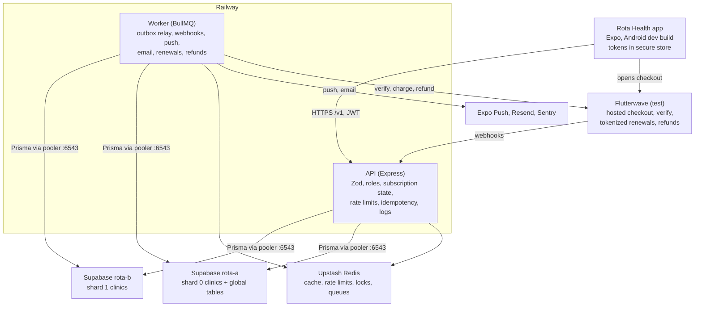

# Rota Health: Product Requirements Document

**Version 2, 10 October 2026.** This version applies all 27 corrections from the live review. The main changes are listed below; the full PRD follows.

**What changed from version 1**

- Billing can no longer charge an Owner twice: one open checkout per clinic, and a paid stale attempt is refunded automatically (sections 11.7 and 11.8).
- Notifications go through a transactional outbox, so a crash between commit and enqueue cannot lose them (sections 5.3, 9, 12.3).
- Unpaid (INCOMPLETE) clinics have defined rules, enforced by one middleware (sections 4, 6.5, 7).
- Missing endpoints added: shift detail, swap detail, invite list; register now takes `deviceId` (section 10).
- The offline cache lasts 30 days and is encrypted with MMKV; the access token lives in memory only (sections 6.8, 14).
- Magic links and password resets are bound to the requesting phone with a PKCE-style verifier (sections 5.9, 15.3).
- The Prisma schema has real relations inside each shard; member removal is blocked while the member has future shifts (section 9).
- Plan changes after period end return `RENEWAL_IN_PROGRESS` instead of giving a free upgrade (section 11.1).
- RESTRICTED blocks only team-scoped writes; settings and logout always work (section 7).
- Quiet hours are stored as one value with one timestamp (sections 9, 13).
- Link invites reserve no seats; email invites reserve one (sections 5.2, 6.1).
- Read-your-own-writes is proven with a delayed streaming replica; rate limiters have defined Redis-down behaviour (section 16).
- CI runs through PgBouncer in transaction mode (section 19).
- Metrics split into "before submission" and "one-week pilot"; goal 1 has a measurement (sections 2, 20).
- The load test runs on one named demo environment with removable seed data (section 18).
- Build plan rebalanced, with weekly LinkedIn posts and docs (section 23).
- Smaller fixes to the overview, screens, risks, app store section, deliverables, future work and assumptions.

## 1. Overview

Rota Health is an Android mobile app that gives a small clinic one trusted shift schedule, approved swaps, alerts that respect sleep, offline access, and a per-seat bill where added seats and upgrades cost only the days left in the month.

**Tagline:** Shift scheduling for clinics that never close.

**Problem.** Grace Point Clinic in Yaba, Lagos, runs 7am to 11pm every day with 11 staff. Its rota is a photo of a paper sheet in a WhatsApp group. Four failures follow from that:

- Staff swap shifts privately. On one Friday a ward had no nurse for 4 hours.
- A 2am edit wakes the whole night team, because WhatsApp has no quiet hours.
- A nurse with no network cannot open the photo, guesses his start time and arrives late.
- The last tool charged a full month for staff hired mid-month, so the owner cancelled it.

**Product.** An Owner creates a clinic and pays a monthly per-seat subscription. Managers draft and publish shifts and approve swaps. Staff see their shifts (also offline), request swaps, and get push alerts that the server holds back during their quiet hours.

**Who it is for.** Clinics, pharmacies and care homes with 5 to 40 shift workers. They are too big for a WhatsApp group and too small for enterprise workforce software.

**Platform.** React Native with Expo, shipped as an Android development build through EAS Build, as the brief requires. React Native and Expo are cross-platform, so the same code can produce an iOS app later without a rewrite (section 25). Backend on Node.js and Express with PostgreSQL on Supabase, Redis on Upstash, BullMQ jobs and Flutterwave in test mode.

## 2. Goals and non-goals

v1 succeeds when every brief requirement for Task A is met, demonstrated and documented, with zero cross-clinic data leaks and zero double charges in tests.

**Product goals**

1. p90 time from app open to My shifts showing data is under 3 seconds, online or offline, measured with a Sentry performance span named `my-shifts-ready`.
2. No swap takes effect without a Manager or Owner approval recorded in the activity feed.
3. No non-urgent push notification is delivered inside a user's quiet hours, measured in the user's own time zone.
4. Every mid-cycle plan or seat change is charged to the cent by the formula in section 11.

**Engineering goals**

1. Every permission and team boundary is enforced on the server and proven by automated tests.
2. Payment state changes only from a verified, re-verified Flutterwave webhook processed in a background job.
3. The activity feed holds p95 under 300 ms with 200 virtual users after caching (section 18).
4. Every payment can be traced by user and minute from logs and database tables.

**Non-goals for v1**

- Clock-in and clock-out, payroll, leave management, patient records.
- Open-shift marketplace or giveaways to anyone. Swaps are direct, between two named people.
- Recurring shifts and qualification matching.
- A web dashboard. All roles use the mobile app.
- iOS builds in v1. The Expo codebase stays cross-platform, so iOS is a later build step, not a rewrite (section 25).
- Ownership transfer between users.
- Real-time updates over WebSockets. The app refetches on open and foreground.
- Overlap checks across different clinics (section 6.3 explains why).

## 3. Personas

Three personas map one to one to the three roles, all at Grace Point Clinic.

| Persona | Role | Context | Main jobs to be done |
| --- | --- | --- | --- |
| Mrs. Adaeze Okafor, 52 | Owner | Founded the clinic. Pays the bills. Uses a mid-range Android phone. Not technical. | Set up the clinic once. Invite staff. Pay a fair monthly bill. Add seats when she hires. Never lose access by surprise. |
| Halima Bello, 38 | Manager (matron) | Plans the weekly rota. Works some night shifts herself. Has an Android phone and an Android tablet. | Draft and publish the week's shifts. Approve or reject swaps quickly. Know every change that happened and who made it. Sleep without 2am pings. |
| Emeka Nwosu, 26 | Staff (nurse) | Rotates between day and night shifts. Commutes by bus with patchy network. Also does locum shifts at a second clinic. | See his next shifts instantly, even offline. Ask a colleague to swap. Get alerted when his shift changes. Switch between his two clinics. See if his shifts at the two clinics clash. |

## 4. User stories

20 stories cover the three roles. Each acceptance criterion is a test case.

### Owner (Adaeze)

**O1. Create a clinic.** As an Owner, I want to create my clinic so my staff have one place for the rota.
- Given a logged-in user with no clinic, when she submits a name (2 to 80 characters) and time zone, then a Team row is created on its shard, she becomes Owner, and the subscription status is `INCOMPLETE` until the first payment webhook is verified.
- Given status `INCOMPLETE`, when she drafts a shift, then it is saved as a draft.
- Given status `INCOMPLETE`, when she invites someone or publishes a shift, then the server returns 402 `PAYMENT_REQUIRED`.

**O2. Pay for a plan.** As an Owner, I want to pay for Starter, Team or Business so my clinic can publish shifts.
- Given status `INCOMPLETE`, when she picks Team with 15 seats and finishes Flutterwave checkout, then status becomes `ACTIVE` only after the webhook job verifies the transaction, and a `CHARGE` ledger row of 5000 cents exists.
- Given she closes checkout without paying, when she returns to the app, then status stays `INCOMPLETE` and the Billing screen shows "You have a payment in progress" with a Continue button that reopens the same checkout link.

**O3. Upgrade mid-cycle.** As an Owner, I want to upgrade and pay only for the days left.
- Given Starter, day 11 of 30, when she upgrades to Team, then checkout opens for exactly 2000 cents.
- Given she taps Confirm twice for the same upgrade, then both taps return the same checkout link and only one payment attempt exists.

**O4. Add seats.** As an Owner, I want to add seats when I hire.
- Given Team, 15 seats, 12 days left, when she adds 3 seats, then checkout opens for exactly 360 cents and the seat count changes to 18 only after the webhook is verified.

**O5. Downgrade.** As an Owner, I want to downgrade at the end of the period without losing paid days.
- Given Team with 9 members plus pending email invites, when she downgrades to Starter, then the server returns 409 `SEAT_LIMIT_EXCEEDED`.
- Given Team with 5 members, when she downgrades to Starter, then no charge happens today and `pendingPlan = STARTER` takes effect at `currentPeriodEnd`.

**O6. Survive a failed renewal.** As an Owner, I want warning before my clinic is restricted.
- Given a renewal charge fails, when 7 days pass without a successful payment, then she has received notifications on days 0, 3 and 6, and on day 7 the clinic becomes read-only.

**O7. Invite staff within my seat limit.**
- Given Starter with 5 active members, when she sends a sixth email invite, then the server returns 409 `SEAT_LIMIT_EXCEEDED` and no invite is created.

### Manager (Halima)

**M1. Draft and publish shifts.** As a Manager, I want to draft a week, then publish it once.
- Given 20 draft shifts, when she publishes them, then each shift's status becomes `PUBLISHED`, `publishedAt` is set, one activity row per shift and one outbox row per affected staff member are written in the same transaction. Staff receive nothing while shifts are drafts.

**M2. Prevent double booking within the clinic.**
- Given Emeka has a published shift 19:00 to 07:00, when she assigns him a shift 06:00 to 14:00 the next day, then the server returns 409 `SHIFT_OVERLAP`.

**M3. Approve a swap.**
- Given a swap in status `ACCEPTED`, when she approves it, then both shifts swap assignees in one database transaction, the swap becomes `APPROVED`, and both staff are notified.

**M4. Reject a swap.**
- Given a swap in status `ACCEPTED`, when she rejects it with an optional reason (max 280 characters), then nothing changes on the shifts and the requester is notified.

**M5. See what changed.**
- Given 10,000 activity rows, when she scrolls the feed, then pages of 20 load in order with no duplicates and no gaps, newest first.

**M6. Quiet hours on every device.**
- Given she sets quiet hours 22:00 to 06:00 on her phone, when her tablet comes to the foreground, then the tablet shows 22:00 to 06:00 within one refetch.
- Given a non-urgent swap request arrives at 02:00 her time, then the push is delayed until 06:00 her time.

### Staff (Emeka)

**S1. See my next shift offline.**
- Given he opened the app online yesterday, when he opens it with no network, then he sees his shifts for the next 14 days and a "Last updated" timestamp.

**S2. Request a swap.**
- Given his published future shift and a colleague's published future shift, when he taps Request swap, then the button disables and the shift shows "Swap requested" instantly. If the server fails, the label reverts and a toast shows the error.

**S3. Accept a swap request.**
- Given a colleague asked to swap with him, when he accepts, then status becomes `ACCEPTED` and Managers are notified.

**S4. Cannot do manager actions.**
- Given a Staff access token, when he calls `DELETE /v1/teams/:teamId/shifts/:shiftId` directly, then the server returns 403 `FORBIDDEN` and the shift still exists.

**S5. Switch clinics.**
- Given membership in two clinics, when he switches, then all queries use the new `teamId` and no data from the first clinic remains on screen.
- Given his shifts at the two clinics overlap, then My shifts shows "Clashes with your shift at <clinic name>" on both.

**S6. Join from an invite.**
- Given an emailed invite link, when he taps it on an Android phone with the app installed, then the app opens on the Join screen for that clinic, and after sign-up he lands in that clinic's Home screen.

**S7. Log out everywhere.**
- Given two logged-in devices, when he taps Log out of all devices, then every refresh token for his user is revoked and any access token is rejected on its next request.

## 5. Core flows

Ten flows cover every state change in v1. Each step names the endpoint, and each error path names the error code.

### 5.1 Clinic creation

1. User signs up (`POST /v1/auth/register`) or logs in.
2. With zero memberships, the app routes to Create clinic.
3. App sends `POST /v1/teams` with `{ name, timeZone }`.
4. Server picks the shard with `fnv1a32(teamId) % 2`, writes the Team and the Owner Membership on that shard, and writes `team_directory` and `user_team_index` rows on shard A, inside a saga (section 16.3).
5. Subscription row is created with status `INCOMPLETE`. The app routes to Choose plan. Until the first payment, the clinic follows the INCOMPLETE rules in section 6.5.

Errors: name invalid → 400 `VALIDATION_FAILED`. Shard write fails after the directory write → the saga deletes the directory row and returns 503 `TRY_AGAIN`.

### 5.2 Invite and deep-link join

1. Owner or Manager sends `POST /v1/teams/:teamId/invites` with `{ mode: "EMAIL", email, role }`, or `{ mode: "LINK", role, maxUses }` for a shareable link (`maxUses` 1 to 40, set by the inviter).
2. Seat check. Email invites: `activeMembers + pendingEmailInvites + 1 <= seats`, else 409 `SEAT_LIMIT_EXCEEDED`. Link invites reserve no seats.
3. Server stores a SHA-256 hash of a 32-byte random token, expiry 7 days, and writes an outbox row for the invite email (Resend).
4. The email link is `https://api.rotahealth.app/l/invite/:token`. That endpoint redirects to `rotahealth://invite/:token`.
5. The app opens the Join screen and calls `GET /v1/invites/:token`, which returns clinic name, role, status and `seatsAvailable`. If `seatsAvailable` is 0, the screen says "This clinic is full. Ask the person who invited you." before any sign-up.
6. User signs up or logs in, then calls `POST /v1/invites/:token/accept`.
7. Server locks the subscription with `SELECT ... FOR UPDATE`, re-checks `activeMembers + pendingEmailInvites (excluding this one) + 1 <= seats`, creates the Membership, marks an email invite `ACCEPTED` or increments a link invite's `uses`, writes an activity row, and returns the team. The app switches to that clinic.

Errors: expired → 410 `INVITE_EXPIRED`. Used up → 410 `INVITE_USED`. Email-bound invite opened by a different email → 403 `INVITE_EMAIL_MISMATCH`. Seats filled → 409 `SEAT_LIMIT_EXCEEDED`. Clinic INCOMPLETE or RESTRICTED → 402. App not installed → the redirect page shows a download link for the development build.

### 5.3 Shift draft and publish

1. Manager creates shifts with `POST /v1/teams/:teamId/shifts`. Status is `DRAFT`.
2. Server rejects any overlap for the assignee within this clinic, across draft and published shifts (409 `SHIFT_OVERLAP`), any `endsAt <= startsAt` (400), and any assignee who is not an active member (422 `ASSIGNEE_NOT_MEMBER`).
3. Manager reviews drafts and calls `POST /v1/teams/:teamId/shifts/publish` with `{ shiftIds }` (max 200).
4. In one transaction: status becomes `PUBLISHED`, `publishedAt` is set, one `shift.published` activity row per shift is written, and one `outbox_events` row per affected user is written.
5. The `outbox-relay` job enqueues the notification jobs and deletes calendar cache keys for the affected weeks (section 12.3).

Errors: clinic INCOMPLETE → 402 `PAYMENT_REQUIRED`. Clinic RESTRICTED → 402 `SUBSCRIPTION_RESTRICTED`. Any shift ID not in this team → 404 for the whole request, nothing published.

### 5.4 Swap request to approval

1. Staff A calls `POST /v1/teams/:teamId/swaps` with `{ requesterShiftId, targetShiftId }` and an `Idempotency-Key`.
2. Server checks: both shifts published, both start in the future, A owns the first shift, B owns the second, no open swap on either shift, and no overlap would result. Status is `REQUESTED`. Activity row and an outbox row to notify B, in the same transaction.
3. B calls `POST .../swaps/:swapId/accept` or `/decline`. On accept, status is `ACCEPTED` and an outbox row notifies Managers and the Owner.
4. A Manager calls `/approve` or `/reject`. Approve swaps the two `assigneeId` values in one transaction, re-checking overlaps with `SELECT ... FOR UPDATE` on both shifts.
5. A delayed `swap-expiry` job runs at the earlier shift's `startsAt`. If the swap is not `APPROVED`, it becomes `EXPIRED`.

Errors: shift changed since request → 409 `SWAP_STALE`. A cancels → `POST .../cancel`, allowed only before approval. Clinic INCOMPLETE or RESTRICTED → 402.

### 5.5 Plan upgrade

1. Owner calls `POST /v1/teams/:teamId/billing/changes/preview` with `{ plan, seats }`. Server returns the proration breakdown in cents.
2. Owner confirms. App calls `POST /v1/teams/:teamId/billing/checkout` with `{ plan, seats }` and a new `Idempotency-Key` (UUID v4).
3. Server recalculates the amount (never trusts the client) and applies the one-open-attempt rule (section 11.7): a PENDING attempt for the same plan and seats is returned as is; one for a different change is marked `SUPERSEDED`.
4. For a new attempt, the server creates a `payment_attempts` row, calls Flutterwave `POST /v3/payments`, stores the hosted link and returns it.
5. App opens the link with `expo-web-browser`. Redirect URL is `rotahealth://billing/return?tx_ref=...`.
6. App shows "Confirming payment" and polls `GET /v1/teams/:teamId/billing/attempts/:txRef` every 3 seconds for up to 2 minutes.
7. Webhook job verifies and applies the change (section 11.8). Polling sees `SUCCEEDED` and the screen shows the new plan.

Errors: same key repeated → the stored response is returned, no new attempt. Change requested at or after `currentPeriodEnd` → 409 `RENEWAL_IN_PROGRESS` ("Your renewal is processing. Try again in a minute."). Webhook late → after 2 minutes the screen says "Still confirming. We will notify you." The billing push arrives when the job completes.

### 5.6 Seat add

Same as 5.5 with `{ plan: currentPlan, seats: newSeats }`. On Starter, `seats > 5` returns 409 `PLAN_SEAT_CAP`, with an upgrade suggestion in the error body.

### 5.7 Downgrade or seat removal

1. Owner calls `POST /v1/teams/:teamId/billing/changes` with `{ plan, seats }` where the monthly cost goes down.
2. Server checks `activeMembers + pendingEmailInvites <= newSeatCap`. Otherwise 409 `SEAT_LIMIT_EXCEEDED` with the number to remove.
3. Server sets `pendingPlan` and `pendingSeats`, writes a `CHANGE_SCHEDULED` ledger row with amount 0, and returns `effectiveAt = currentPeriodEnd`.
4. Renewal job applies it and charges the new monthly price. The Owner can cancel the pending change any time before then.

### 5.8 Failed renewal

1. Hourly `renewals:scan` job finds subscriptions with `currentPeriodEnd <= now()` and status `ACTIVE`.
2. It calls Flutterwave tokenized charge with the saved card token and `txRef = "rh_renew_" + subscriptionId + "_" + periodNumber`.
3. Failure: status becomes `PAST_DUE`, `graceEndsAt = now + 7 days`. Notifications for day 0, day 3 and day 6 are scheduled, plus an email.
4. Owner pays through `POST /v1/teams/:teamId/billing/checkout` with `{ reason: "renewal" }`. A verified webhook sets status `ACTIVE` and starts a new period from the payment date.
5. If `graceEndsAt` passes, status becomes `RESTRICTED`. Team-scoped writes return 402 `SUBSCRIPTION_RESTRICTED` (section 7). Reads and user-level routes still work.

### 5.9 Password reset

1. The app creates a 32-byte random `codeVerifier`, stores it in `expo-secure-store`, and calls `POST /v1/auth/password/forgot` with `{ email, deviceId, codeChallenge }`, where `codeChallenge = base64url(SHA-256(codeVerifier))`. The server always returns 202, whether the email exists or not.
2. If the user exists, the server stores a hashed 32-byte token with `deviceId` and `codeChallenge`, expiry 30 minutes, and emails `https://api.rotahealth.app/l/reset/:token`, which redirects to `rotahealth://auth/reset?token=...`.
3. The app calls `POST /v1/auth/password/reset` with `{ token, codeVerifier, deviceId, newPassword }`. Server checks hash, expiry, `usedAt IS NULL`, matching `deviceId`, and `SHA-256(codeVerifier) == codeChallenge`. It sets `usedAt`, updates the argon2id hash, and revokes all refresh tokens for the user.
4. The "Check your email" screen says: "Open the link on this phone."

Errors: expired, used, wrong device or wrong verifier → 410 `TOKEN_INVALID`. Weak password (under 10 characters) → 400.

### 5.10 Log out of all devices

1. `POST /v1/auth/logout-all` with a valid access token.
2. Server sets `revokedAt` on every refresh token of the user, increments `users.tokenVersion`, and deletes the Redis key `auth:tv:{userId}`.
3. Any access token with an older `tv` claim fails with 401 `TOKEN_REVOKED` on its next request. Device tokens for push are deleted so logged-out phones stop receiving alerts.

## 6. Feature requirements

Each brief feature below has rules, edge cases and acceptance criteria. Flows in section 5 show the step order.

### 6.1 Sign up, log in, log out, invites

**Rules**

- Email is unique, lowercased and trimmed. Password is 10 to 128 characters, hashed with argon2id (memory 19 MiB, iterations 2, parallelism 1).
- Register and login both take `deviceId`, the install ID kept in secure store, so every refresh token is bound to a device.
- Login methods: email and password, and magic link. Magic link tokens are 32 random bytes, stored as SHA-256 hashes, valid 15 minutes, single use, and bound to the requesting install with `deviceId` and a `codeChallenge` (section 15.3). The link must be opened on the phone that asked for it.
- Log out revokes the current refresh token family and deletes this device's push token.
- Invites: EMAIL (one use, reserves one seat) or LINK (multi-use, `maxUses` set by the inviter, 1 to 40, reserves no seats, revocable). Both expire after 7 days. Only the Owner can invite a Manager.

**Edge cases**

- Login for an unknown email returns the same 401 `INVALID_CREDENTIALS` as a wrong password, with similar timing (argon2 verify against a dummy hash).
- Magic link requested twice: both links work until one is used or 15 minutes pass. Using one marks every unused magic link token for that user as used.
- Magic link opened on a different phone: 410 `TOKEN_INVALID`; the screen says "Open this link on the phone where you requested it, or request a new one here."
- Invite accepted by a user already in the team: 409 `ALREADY_MEMBER`, invite stays unused.

**Acceptance criteria**

- Given a used magic link token, when it is posted again, then the server returns 410 `TOKEN_INVALID`.
- Given a valid magic link token and the wrong `codeVerifier`, then the server returns 410 `TOKEN_INVALID` and the token stays unused.
- Given a revoked link invite, when a user opens it, then the Join screen shows "This invite is no longer active".

### 6.2 Role-based permissions

**Rules**

- Roles: `OWNER`, `MANAGER`, `STAFF`, stored on `memberships.role`. Section 7 is the full matrix.
- Middleware order on every team route: `requestId` → `authenticate` (JWT) → `resolveTeam` (directory lookup, shard client) → `requireMembership` → `requireRole([...])` → `requireSubscriptionState` → `validate(zodSchema)` → handler.
- Role checks run on the server only. The app hides buttons for usability, never for security.
- A request for a resource in a team where the caller has no membership returns 404 `NOT_FOUND`, not 403, so IDs from other clinics do not leak.

**Edge cases**

- A Manager demoted to Staff while logged in: the next request re-reads the role from the database (role is not cached in the JWT).
- The Owner cannot be removed or demoted. Attempt returns 409 `OWNER_IMMUTABLE`.
- Removing a member who has future shifts returns 409 `MEMBER_HAS_FUTURE_SHIFTS` with the count. A Manager reassigns or deletes those shifts first. Open swaps involving the member become `CANCELLED` on removal.

**Acceptance criteria**

- Given a Staff token, when `DELETE /v1/teams/:teamId/shifts/:shiftId` is called with Postman, then the response is 403 `FORBIDDEN` and the row still exists (test `permissions.staff-delete-shift.test.ts`).

### 6.3 Shift calendar and activity feed

**Rules**

- Calendar: `GET /v1/teams/:teamId/shifts?weekStart=YYYY-MM-DD` returns all shifts of that ISO week in the clinic's time zone. Staff see published shifts only. Managers and Owner see drafts too.
- Shift detail: `GET /v1/teams/:teamId/shifts/:shiftId`, used by deep links.
- Times are stored as `timestamptz(3)` in UTC and shown in the clinic's time zone.
- Overlap is enforced within one clinic only. The server never compares shifts across clinics, because doing so would reveal one clinic's schedule to another. My shifts, which already merges all the user's clinics, shows "Clashes with your shift at <clinic name>" when two of the user's own shifts overlap. This check runs on the phone.
- Activity types: `shift.created`, `shift.updated`, `shift.deleted`, `shift.published`, `swap.requested`, `swap.accepted`, `swap.declined`, `swap.approved`, `swap.rejected`, `swap.expired`, `member.joined`, `member.removed`, `billing.changed`. Draft edits do not write activity rows.
- Feed: cursor pagination, 20 items per page (section 17).

**Edge cases**

- A shift crossing midnight appears on both days in the calendar, labelled "continues" on the second day.
- Daylight saving does not apply to Africa/Lagos, but the server uses the IANA zone name so other zones work.
- A deep link to a deleted shift returns 404 `SHIFT_NOT_FOUND`; the screen shows "This shift was removed."

**Acceptance criteria**

- Given a Staff user, when the calendar loads, then no draft shift is present in the response body.

### 6.4 Shift swaps with approval

**Rules**

- States: `REQUESTED` → `ACCEPTED` or `DECLINED` → `APPROVED` or `REJECTED`. Also `CANCELLED` (by requester before approval, or on member removal) and `EXPIRED` (by job).
- One open swap per shift. Open means `REQUESTED` or `ACCEPTED`.
- Approval swaps both `assigneeId` values in one transaction with row locks, then re-runs the overlap check.
- Swap requests use optimistic updates with rollback (section 14).
- Swap detail: `GET /v1/teams/:teamId/swaps/:swapId`, used by deep links.

**Edge cases**

- A Manager edits one of the shifts while a swap is open: the swap becomes `EXPIRED` with reason `SHIFT_CHANGED` and both staff are notified.
- Requester removed from the team: open swaps become `CANCELLED`.

**Acceptance criteria**

- Given two concurrent approve calls on one swap, then exactly one returns 200 and the other returns 409 `SWAP_STATE_CHANGED`.

### 6.5 Subscription plans with proration

**Rules**

- Plans in cents: Starter 2000 (max 5 seats), Team 5000 (15 included, extra 300), Business 12000 (40 included, extra 200).
- `subscription.seats` is the purchased seat capacity. Monthly price = base + max(0, seats - included) × extraSeatPrice.
- Upgrades and seat additions are charged today by the section 11 formula. Downgrades and removals are scheduled for period end.
- All amounts are integers in cents. No floats in billing code.
- **Subscription states and what they allow.** One middleware, `requireSubscriptionState`, enforces this for every `/teams/:teamId/...` route:
    - `INCOMPLETE` (never paid): clinic settings, drafting shifts and billing routes are allowed. Invites, publish and all swap actions return 402 `PAYMENT_REQUIRED`.
    - `ACTIVE` and `PAST_DUE`: everything allowed.
    - `RESTRICTED`: reads and billing routes allowed. All other team-scoped writes return 402 `SUBSCRIPTION_RESTRICTED`.
    - User-level routes (`/me/...`, `/auth/...`) are never blocked by subscription state.

**Edge cases**

- Two changes in one period are each prorated against the then-current configuration.
- A pending downgrade followed by an upgrade in the same period: the pending downgrade is cancelled and the upgrade is charged against the current plan.
- A change requested at or after `currentPeriodEnd`, before the renewal job has run: 409 `RENEWAL_IN_PROGRESS`, and the renewal job for that subscription is enqueued immediately.

**Acceptance criteria**

- The 13 cases in section 11.4 pass in `proration.test.ts`.
- Given status `INCOMPLETE`, when an invite is created, then the server returns 402 `PAYMENT_REQUIRED`.

### 6.6 Push notifications

**Rules**

- Device token registration after login: `PUT /v1/me/devices/:deviceId` with `{ expoPushToken, platform }`. `deviceId` is a UUID generated once per install and kept in secure store.
- Sending happens only in the `notifications` BullMQ worker through the Expo Push API, which delivers through FCM on Android. The FCM credentials live in EAS, never in the app. Handlers never enqueue directly; they write outbox rows (section 12.3).
- Groups: `shifts`, `swaps`, `billing`. Each can be turned off, except billing failures to the Owner.
- Each push carries `data.url`, a deep link such as `rotahealth://shifts/:shiftId`, and `data.teamId`.

**Edge cases**

- Expo returns `DeviceNotRegistered` in a ticket or receipt: the token row is deleted.
- User belongs to two clinics: the push title starts with the clinic name, and tapping it switches the active clinic before opening the screen.

**Acceptance criteria**

- Given a request that publishes shifts, then the HTTP handler returns before any call to Expo is made (asserted by spying on the Expo client in tests).
- Given the process crashes after the publish transaction commits and before the relay runs, then after restart the notification is still sent exactly once.

### 6.7 Settings sync

**Rules**

- Server-stored fields: `quietHours` (one value: `{ start: "HH:mm", end: "HH:mm" }` or null), `timeZone`, `notifyShifts`, `notifySwaps`, `notifyBilling`, `language`, `theme`.
- Each field has its own server-set `updatedAt`; quiet hours has one `updatedAt` for both parts. Latest write wins per field (section 13).
- Settings changes use optimistic updates with rollback.

**Acceptance criteria**

- Given a change on device A, when device B returns to the foreground, then B shows the new value after one `GET /v1/me/settings`.
- Given a `PATCH` that sends only the end of quiet hours, then the server returns 400 `VALIDATION_FAILED`.

### 6.8 Offline upcoming shifts

**Rules**

- The app persists three queries only, using `shouldDehydrateQuery`: `["me"]`, `["me","settings"]` and `["me","shifts","upcoming"]` (the user's shifts for the next 14 days across all their clinics).
- The persisted cache is stored in `react-native-mmkv` with an `encryptionKey`. The key is 32 random bytes generated on first launch and kept in `expo-secure-store`. Shift notes can mention staff health ("covering for Bisi, sick leave"), so the cache is encrypted at rest.
- For the three persisted queries, `gcTime` and the persister's `maxAge` are 30 days. The persister's `buster` is the app version, so an update with a new data shape starts clean.
- Every response includes `serverTime`. The app stores `lastSyncedAt` and shows "Last updated 3 hours ago" on My shifts.
- Offline mode is read-only. Write buttons show "You are offline" and do nothing.

**Edge cases**

- On logout, the persisted cache and its encryption key are deleted, so the next user cannot see the previous user's shifts.
- Cache older than 24 hours shows a banner "These shifts may be out of date". After 30 days the cache is discarded and My shifts shows "Connect to the internet to load your shifts".

**Acceptance criteria**

- Given airplane mode after one online launch, when the app cold starts, then My shifts renders the cached shifts in under 2 seconds with the last updated time.
- Given airplane mode 3 days after the last online launch, then My shifts still renders the cached shifts with the out-of-date banner.

## 7. Permissions matrix

The server enforces every cell below with `requireRole` and `requireSubscriptionState`. "Own" means the caller is the shift assignee or the swap party. Any action on a team the caller is not in returns 404.

| Action | Owner | Manager | Staff |
| --- | --- | --- | --- |
| View clinic profile and member list | Yes | Yes | Yes |
| Rename clinic, change clinic time zone | Yes | No | No |
| View pending invites | Yes | Yes | No |
| Invite Staff | Yes | Yes | No |
| Invite Manager | Yes | No | No |
| Revoke an invite | Yes | Yes (Staff invites only) | No |
| Change a member's role | Yes | No | No |
| Remove a member (blocked while they have future shifts) | Yes | Yes (Staff only) | No |
| Leave the clinic | No (Owner cannot leave) | Yes | Yes |
| View published shifts | Yes | Yes | Yes |
| View draft shifts | Yes | Yes | No |
| Create, edit, delete shifts | Yes | Yes | No |
| Publish shifts | Yes | Yes | No |
| Request a swap | Own shifts | Own shifts | Own shifts |
| Accept or decline a swap | When target | When target | When target |
| Cancel a swap | When requester | When requester | When requester |
| Approve or reject a swap | Yes | Yes (not a swap they are party to) | No |
| View activity feed | Yes | Yes | Yes |
| View billing and plan | Yes | Plan name only | No |
| Preview, upgrade, downgrade, add or remove seats | Yes | No | No |
| Start checkout or retry a failed payment | Yes | No | No |
| View billing history (ledger) | Yes | No | No |
| Edit own settings and devices | Yes | Yes | Yes |
| Log out, log out of all devices | Yes | Yes | Yes |
| Team-scoped writes while that clinic is INCOMPLETE | Settings, drafts, billing only | Drafts only | No |
| Team-scoped writes (`/teams/:teamId/...`) while that clinic is RESTRICTED | Billing routes only | No | No |
| User-level routes (`/me/...`, `/auth/...`) in any subscription state | Always | Always | Always |

When a Staff member hits a 402 in a restricted clinic, the app shows a banner: "Your clinic's subscription has lapsed. Ask your clinic owner."

## 8. Screens and navigation

The app has 27 screens in Expo Router: an auth stack, a five-tab main area, and modal stacks for editing and billing. Deep links use the scheme `rotahealth://`.

**Navigation**

- Auth stack (signed out): Welcome, Sign up, Log in, Magic link sent, Forgot password, Reset password.
- Onboarding (signed in, no clinic): Create clinic, Choose plan.
- Tabs (signed in, active clinic): My shifts, Calendar, Swaps, Activity, More. Staff see all five tabs; Billing inside More is Owner only.
- A clinic switcher sits in the header when the user has 2 or more clinics.

**Shared state rules.** Every list screen has four designed states: loading (skeleton rows), empty (illustration plus one action), error (message, error code, Retry button), end of list ("You're all caught up"). Every write button shows a spinner and disables while its request runs. Offline shows a top banner "Offline. Showing saved shifts." A 402 from a restricted or unpaid clinic shows a banner that explains why, not a raw error.

| Screen | Route / deep link | Roles | Purpose | Screen-specific states |
| --- | --- | --- | --- | --- |
| Welcome | `/welcome` | Signed out | Entry: sign up or log in | None |
| Sign up | `/auth/register` | Signed out | Email, name, password | Field errors from 400 response |
| Log in | `/auth/login` | Signed out | Password or magic link | 429 shows "Try again in N seconds" |
| Magic link sent | `/auth/magic-sent` | Signed out | Tells user to check email and open the link on this phone | Resend disabled for 60 s |
| Magic link handler | `rotahealth://auth/magic?token=` | Signed out | Exchanges token and verifier for a session | Expired or wrong-device token shows a resend button |
| Forgot password | `/auth/forgot` | Signed out | Request reset email | Always shows "If an account exists, we sent a link. Open it on this phone." |
| Reset password | `rotahealth://auth/reset?token=` | Signed out | Set new password | Invalid token state |
| Create clinic | `/onboarding/clinic` | Signed in | Name and time zone | None |
| Choose plan | `/onboarding/plan` | Owner | Pick plan and seats, start checkout | Payment in progress state with Continue |
| Join clinic | `rotahealth://invite/:token` | Any | Show clinic and role, accept | Expired, used, clinic full (checked before sign-up) |
| My shifts (home) | `/(tabs)/home` | All | Next 14 days, own shifts across clinics | Offline with last updated time; out-of-date banner after 24 h; clash warning; empty "No shifts in the next 14 days" |
| Calendar | `/(tabs)/calendar?week=` | All | Week grid of the clinic | Drafts shown dashed for Manager and Owner |
| Shift detail | `rotahealth://shifts/:shiftId` | All | Times, position, notes, swap button | 404 `SHIFT_NOT_FOUND` shows "This shift was removed" |
| Shift editor | `/shifts/new`, `/shifts/:id/edit` | Owner, Manager | Create or edit a draft or published shift | 409 overlap shown inline on the assignee field |
| Publish review | `/shifts/publish` | Owner, Manager | List drafts, publish selected | Empty "No drafts to publish"; INCOMPLETE banner with "Choose a plan" |
| Swaps inbox | `/(tabs)/swaps` | All | Incoming, outgoing, awaiting approval | Three segments, each with its own empty state |
| New swap | `/swaps/new?shiftId=` | All | Pick colleague shift to swap with | No eligible shifts state |
| Swap detail | `rotahealth://swaps/:swapId` | Parties, Manager, Owner | Accept, decline, approve, reject, cancel | 404 `SWAP_NOT_FOUND`; stale or expired swap state |
| Activity feed | `rotahealth://feed` | All | Paginated history | Infinite scroll, pull to refresh, end of list |
| Team | `/more/team` | All | Members, roles, and (for Owner and Manager) pending invites with Revoke | Remove blocked state shows the number of future shifts to reassign |
| Invite member | `/more/team/invite` | Owner, Manager | Email invite or share link with chosen `maxUses` | Seat limit reached with upgrade link for Owner |
| Billing | `rotahealth://billing` | Owner | Plan, seats, next renewal, status, pending change | `PAST_DUE` banner with days left; `RESTRICTED` banner; "You have a payment in progress" with Continue |
| Change plan | `/more/billing/change` | Owner | Pick plan and seats, see proration preview | Downgrade blocked state with member count; renewal in progress state |
| Billing history | `/more/billing/history` | Owner | Ledger rows, newest first: type, amount, date | Empty "No charges yet" |
| Payment return | `rotahealth://billing/return?tx_ref=` | Owner | Poll attempt status after checkout | Confirming, succeeded, failed, refunded, still confirming after 2 min |
| Settings | `rotahealth://settings` | All | Quiet hours, time zone, notification groups, language, theme | Rollback toast on failed save; save disabled offline |
| Sessions | `/more/sessions` | All | List devices, log out of all devices | Confirm dialog |

## 9. Data model

One Prisma schema is migrated to both Supabase projects. Team-owned tables live on the clinic's shard; user-level and payment-routing tables live only on shard A (Supabase project `rota-a`). Every team-owned table has `team_id`, an index that starts with it, and a real foreign key to `teams` inside its shard.

| Table | Location | Team-owned | Purpose |
| --- | --- | --- | --- |
| `users` | Shard A (global) | No | Accounts, password hash, `token_version` |
| `refresh_tokens` | Shard A (global) | No | Hashed rotating refresh tokens, family IDs |
| `auth_tokens` | Shard A (global) | No | Magic link and password reset tokens, hashed, bound to `device_id` and `code_challenge` |
| `devices` | Shard A (global) | No | Expo push token per user per install |
| `user_settings` | Shard A (global) | No | Settings with per-field `updated_at`; quiet hours stored as one value |
| `team_directory` | Shard A (global) | Directory | `team_id` to `shard_id` map |
| `user_team_index` | Shard A (global) | Directory | Which clinics a user belongs to, for the switcher; `team_name` updated on rename |
| `webhook_events` | Shard A (global) | No | Flutterwave event dedupe |
| `idempotency_keys` | Shard A (global) | No | Stored responses for repeated keys |
| `notification_log` | Shard A (global) | No | Every push attempt and its outcome |
| `teams` | Clinic's shard | Yes | Clinic name, time zone |
| `memberships` | Clinic's shard | Yes | User, role, status |
| `invites` | Clinic's shard | Yes | Email or link invites |
| `shifts` | Clinic's shard | Yes | Shift times, assignee, status, `published_at` |
| `swap_requests` | Clinic's shard | Yes | Swap state machine |
| `activities` | Clinic's shard | Yes | Feed rows |
| `subscriptions` | Clinic's shard | Yes | Current plan, seats, period, status |
| `ledger_entries` | Clinic's shard | Yes | Append-only money rows |
| `payment_attempts` | Clinic's shard | Yes | One row per checkout or tokenized charge |
| `payment_methods` | Clinic's shard | Yes | Saved Flutterwave card token for renewals |
| `outbox_events` | Clinic's shard | Yes | Side effects (notifications, emails, cache invalidation) written in the same transaction as the change |

Why split this way: auth, settings and push are per user and must work before the app knows which clinic is active. Money and shifts belong to one clinic and stay together on one shard, so a clinic's billing transaction never crosses databases. [ASSUMPTION: `webhook_events` and `idempotency_keys` are global because a webhook arrives before the server knows the team; the team is parsed from `tx_ref` after dedupe.]

**Foreign keys.** Inside a shard, every team-owned model has a real relation to `Team` with `onDelete: Restrict`. A shift's assignee is a composite foreign key from `shifts (team_id, assignee_id)` to `memberships (team_id, user_id)`, so the database rejects a shift for someone who was never a member of that clinic. User IDs that point at `users` on shard A are plain UUIDs, because Postgres cannot enforce a foreign key across two databases; the app checks them.

**Member removal.** Memberships are soft-deleted (`status = REMOVED`). Because the composite key still matches a removed member, the server blocks removal while the member has future shifts (409 `MEMBER_HAS_FUTURE_SHIFTS`). Past shifts keep their assignee for history.

**Ledger is append-only.** A Postgres trigger on `ledger_entries` raises an exception on `UPDATE` or `DELETE`. The app role also has those privileges revoked. Corrections are new rows of type `ADJUSTMENT` that reference `corrects_entry_id`.

```prisma
generator client { provider = "prisma-client-js" }

datasource db {
  provider  = "postgresql"
  url       = env("DATABASE_URL")      // pooler, port 6543, ?pgbouncer=true&connection_limit=10
  directUrl = env("DIRECT_URL")        // direct, migrations only
}

enum Role { OWNER MANAGER STAFF }
enum MembershipStatus { ACTIVE REMOVED }
enum InviteStatus { PENDING ACCEPTED REVOKED EXPIRED }
enum InviteMode { EMAIL LINK }
enum ShiftStatus { DRAFT PUBLISHED }
enum SwapStatus { REQUESTED ACCEPTED DECLINED APPROVED REJECTED CANCELLED EXPIRED }
enum Plan { STARTER TEAM BUSINESS }
enum SubStatus { INCOMPLETE ACTIVE PAST_DUE RESTRICTED }
enum LedgerType { CHARGE PRORATION_CHARGE PRORATION_CREDIT REFUND ADJUSTMENT CHANGE_SCHEDULED CHANGE_APPLIED PAYMENT_FAILED }
enum AttemptStatus { CREATED PENDING SUCCEEDED FAILED ABANDONED SUPERSEDED REFUND_PENDING REFUNDED }
enum AuthTokenKind { MAGIC_LINK PASSWORD_RESET }

// User IDs are plain UUIDs in every team-owned table: users live on shard A,
// and Postgres cannot enforce a foreign key across databases.

// ---------- Global tables (shard A only) ----------
model User {
  id            String   @id @default(uuid()) @db.Uuid
  email         String   @unique
  name          String   @db.VarChar(80)
  passwordHash  String?  @map("password_hash")
  tokenVersion  Int      @default(0) @map("token_version")
  createdAt     DateTime @default(now()) @map("created_at") @db.Timestamptz(3)
  @@map("users")
}

model RefreshToken {
  id         String    @id @default(uuid()) @db.Uuid
  userId     String    @map("user_id") @db.Uuid
  familyId   String    @map("family_id") @db.Uuid
  tokenHash  String    @unique @map("token_hash")
  deviceId   String    @map("device_id") @db.Uuid
  usedAt     DateTime? @map("used_at") @db.Timestamptz(3)
  revokedAt  DateTime? @map("revoked_at") @db.Timestamptz(3)
  expiresAt  DateTime  @map("expires_at") @db.Timestamptz(3)
  createdAt  DateTime  @default(now()) @map("created_at") @db.Timestamptz(3)
  @@index([userId])
  @@index([familyId])
  @@map("refresh_tokens")
}

model AuthToken {
  id             String        @id @default(uuid()) @db.Uuid
  userId         String        @map("user_id") @db.Uuid
  kind           AuthTokenKind
  tokenHash      String        @unique @map("token_hash")
  deviceId       String        @map("device_id") @db.Uuid       // install that requested it
  codeChallenge  String        @map("code_challenge")            // base64url(SHA-256(verifier))
  expiresAt      DateTime      @map("expires_at") @db.Timestamptz(3)
  usedAt         DateTime?     @map("used_at") @db.Timestamptz(3)
  @@index([userId, kind])
  @@map("auth_tokens")
}

model Device {
  id             String   @id @db.Uuid               // install ID from the app
  userId         String   @map("user_id") @db.Uuid
  expoPushToken  String   @unique @map("expo_push_token")
  platform       String   @db.VarChar(10)            // "android" in v1
  lastSeenAt     DateTime @map("last_seen_at") @db.Timestamptz(3)
  @@index([userId])
  @@map("devices")
}

model UserSettings {
  userId               String   @id @map("user_id") @db.Uuid
  quietHoursStart      String?  @map("quiet_hours_start") @db.VarChar(5)   // "22:00"
  quietHoursEnd        String?  @map("quiet_hours_end") @db.VarChar(5)     // "06:00"
  quietHoursUpdatedAt  DateTime @map("quiet_hours_updated_at") @db.Timestamptz(3)  // one timestamp for both parts
  timeZone             String   @default("Africa/Lagos") @map("time_zone")
  timeZoneAt           DateTime @map("time_zone_updated_at") @db.Timestamptz(3)
  notifyShifts         Boolean  @default(true) @map("notify_shifts")
  notifyShiftsAt       DateTime @map("notify_shifts_updated_at") @db.Timestamptz(3)
  notifySwaps          Boolean  @default(true) @map("notify_swaps")
  notifySwapsAt        DateTime @map("notify_swaps_updated_at") @db.Timestamptz(3)
  notifyBilling        Boolean  @default(true) @map("notify_billing")
  notifyBillingAt      DateTime @map("notify_billing_updated_at") @db.Timestamptz(3)
  language             String   @default("en") @db.VarChar(5)
  languageAt           DateTime @map("language_updated_at") @db.Timestamptz(3)
  theme                String   @default("system") @db.VarChar(6)       // light | dark | system
  themeAt              DateTime @map("theme_updated_at") @db.Timestamptz(3)
  @@map("user_settings")
}
// Raw SQL: ALTER TABLE user_settings ADD CONSTRAINT quiet_hours_pair
//   CHECK ((quiet_hours_start IS NULL) = (quiet_hours_end IS NULL));

model TeamDirectory {
  teamId     String   @id @map("team_id") @db.Uuid
  shardId    Int      @map("shard_id")              // 0 = rota-a, 1 = rota-b
  createdAt  DateTime @default(now()) @map("created_at") @db.Timestamptz(3)
  @@map("team_directory")
}

model UserTeamIndex {
  userId    String @map("user_id") @db.Uuid
  teamId    String @map("team_id") @db.Uuid
  teamName  String @map("team_name") @db.VarChar(80)   // updated by PATCH /teams/:teamId
  role      Role
  @@id([userId, teamId])
  @@map("user_team_index")
}

model WebhookEvent {
  id           String    @id                          // "<event>:<data.id>" from Flutterwave
  txRef        String    @map("tx_ref")
  receivedAt   DateTime  @default(now()) @map("received_at") @db.Timestamptz(3)
  processedAt  DateTime? @map("processed_at") @db.Timestamptz(3)
  outcome      String?   @db.VarChar(40)
  payload      Json
  @@index([txRef])
  @@map("webhook_events")
}

model IdempotencyKey {
  key           String    @id @db.Uuid
  userId        String    @map("user_id") @db.Uuid
  route         String
  requestHash   String    @map("request_hash")       // SHA-256 of the body
  statusCode    Int?      @map("status_code")
  responseBody  Json?     @map("response_body")
  lockedUntil   DateTime? @map("locked_until") @db.Timestamptz(3)
  createdAt     DateTime  @default(now()) @map("created_at") @db.Timestamptz(3)
  @@index([createdAt])                                // purge after 24 h
  @@map("idempotency_keys")
}

model NotificationLog {
  id          String   @id @default(uuid()) @db.Uuid
  userId      String   @map("user_id") @db.Uuid
  teamId      String?  @map("team_id") @db.Uuid
  kind        String   @db.VarChar(40)
  urgent      Boolean
  status      String   @db.VarChar(20)               // sent | delayed | skipped_pref | skipped_stale | failed
  ticketId    String?  @map("ticket_id")
  createdAt   DateTime @default(now()) @map("created_at") @db.Timestamptz(3)
  @@index([userId, createdAt])
  @@map("notification_log")
}

// ---------- Team-owned tables (clinic's shard) ----------
model Team {
  id             String          @id @db.Uuid         // generated before shard choice
  name           String          @db.VarChar(80)
  timeZone       String          @default("Africa/Lagos") @map("time_zone")
  ownerId        String          @map("owner_id") @db.Uuid
  createdAt      DateTime        @default(now()) @map("created_at") @db.Timestamptz(3)
  memberships    Membership[]
  invites        Invite[]
  shifts         Shift[]
  swapRequests   SwapRequest[]
  activities     Activity[]
  subscription   Subscription?
  ledgerEntries  LedgerEntry[]
  paymentAttempts PaymentAttempt[]
  paymentMethod  PaymentMethod?
  outboxEvents   OutboxEvent[]
  @@map("teams")
}

model Membership {
  id        String           @id @default(uuid()) @db.Uuid
  teamId    String           @map("team_id") @db.Uuid
  userId    String           @map("user_id") @db.Uuid
  role      Role
  status    MembershipStatus @default(ACTIVE)
  joinedAt  DateTime         @default(now()) @map("joined_at") @db.Timestamptz(3)
  team      Team             @relation(fields: [teamId], references: [id], onDelete: Restrict)
  shifts    Shift[]          @relation("ShiftAssignee")
  @@unique([teamId, userId])
  @@index([teamId, status])
  @@map("memberships")
}

model Invite {
  id         String       @id @default(uuid()) @db.Uuid
  teamId     String       @map("team_id") @db.Uuid
  mode       InviteMode
  email      String?
  role       Role
  tokenHash  String       @unique @map("token_hash")
  status     InviteStatus @default(PENDING)
  maxUses    Int          @default(1) @map("max_uses")    // EMAIL = 1; LINK = 1 to 40, set by inviter
  uses       Int          @default(0)
  invitedBy  String       @map("invited_by") @db.Uuid
  expiresAt  DateTime     @map("expires_at") @db.Timestamptz(3)
  team       Team         @relation(fields: [teamId], references: [id], onDelete: Restrict)
  @@index([teamId, status])
  @@map("invites")
}

model Shift {
  id           String        @id @default(uuid()) @db.Uuid
  teamId       String        @map("team_id") @db.Uuid
  assigneeId   String        @map("assignee_id") @db.Uuid
  position     String        @db.VarChar(40)
  notes        String?       @db.VarChar(500)
  startsAt     DateTime      @map("starts_at") @db.Timestamptz(3)
  endsAt       DateTime      @map("ends_at") @db.Timestamptz(3)
  status       ShiftStatus   @default(DRAFT)
  publishedAt  DateTime?     @map("published_at") @db.Timestamptz(3)
  version      Int           @default(1)
  createdBy    String        @map("created_by") @db.Uuid
  updatedAt    DateTime      @updatedAt @map("updated_at") @db.Timestamptz(3)
  team         Team          @relation(fields: [teamId], references: [id], onDelete: Restrict)
  assignee     Membership    @relation("ShiftAssignee", fields: [teamId, assigneeId], references: [teamId, userId], onDelete: Restrict)
  requesterSwaps SwapRequest[] @relation("RequesterShift")
  targetSwaps    SwapRequest[] @relation("TargetShift")
  @@index([teamId, startsAt])
  @@index([teamId, assigneeId, startsAt])
  @@map("shifts")
}
// Overlap safety net (raw SQL migration):
// ALTER TABLE shifts ADD CONSTRAINT shifts_no_overlap EXCLUDE USING gist
//   (team_id WITH =, assignee_id WITH =, tstzrange(starts_at, ends_at) WITH &&) DEFERRABLE INITIALLY DEFERRED;
//   -- needs btree_gist; deferred so a swap's two updates are checked together at commit

model SwapRequest {
  id                String     @id @default(uuid()) @db.Uuid
  teamId            String     @map("team_id") @db.Uuid
  requesterId       String     @map("requester_id") @db.Uuid
  targetUserId      String     @map("target_user_id") @db.Uuid
  requesterShiftId  String     @map("requester_shift_id") @db.Uuid
  targetShiftId     String     @map("target_shift_id") @db.Uuid
  status            SwapStatus @default(REQUESTED)
  decidedBy         String?    @map("decided_by") @db.Uuid
  reason            String?    @db.VarChar(280)
  createdAt         DateTime   @default(now()) @map("created_at") @db.Timestamptz(3)
  updatedAt         DateTime   @updatedAt @map("updated_at") @db.Timestamptz(3)
  team              Team       @relation(fields: [teamId], references: [id], onDelete: Restrict)
  requesterShift    Shift      @relation("RequesterShift", fields: [requesterShiftId], references: [id], onDelete: Cascade)
  targetShift       Shift      @relation("TargetShift", fields: [targetShiftId], references: [id], onDelete: Cascade)
  @@index([teamId, status])
  @@map("swap_requests")
}
// Deleting a shift first marks its open swaps EXPIRED and notifies both staff (via outbox),
// then the delete cascades the swap rows; the activity feed keeps the history.
// Partial unique (raw SQL): one open swap per shift
// CREATE UNIQUE INDEX one_open_swap_req ON swap_requests (requester_shift_id) WHERE status IN ('REQUESTED','ACCEPTED');
// CREATE UNIQUE INDEX one_open_swap_tgt ON swap_requests (target_shift_id) WHERE status IN ('REQUESTED','ACCEPTED');

model Activity {
  id         String   @id @default(uuid()) @db.Uuid
  teamId     String   @map("team_id") @db.Uuid
  type       String   @db.VarChar(40)
  actorId    String   @map("actor_id") @db.Uuid
  subjectId  String?  @map("subject_id") @db.Uuid
  payload    Json
  createdAt  DateTime @default(now()) @map("created_at") @db.Timestamptz(3)
  team       Team     @relation(fields: [teamId], references: [id], onDelete: Restrict)
  // Cursor index created in migration 0005 (section 17), after the "before" query plan is captured:
  // CREATE INDEX CONCURRENTLY activities_feed_idx ON activities (team_id, created_at DESC, id DESC);
  @@map("activities")
}

model Subscription {
  id                  String     @id @default(uuid()) @db.Uuid
  teamId              String     @unique @map("team_id") @db.Uuid
  plan                Plan
  seats               Int
  status              SubStatus  @default(INCOMPLETE)
  currentPeriodStart  DateTime?  @map("current_period_start") @db.Timestamptz(3)
  currentPeriodEnd    DateTime?  @map("current_period_end") @db.Timestamptz(3)
  periodNumber        Int        @default(0) @map("period_number")
  pendingPlan         Plan?      @map("pending_plan")
  pendingSeats        Int?       @map("pending_seats")
  graceEndsAt         DateTime?  @map("grace_ends_at") @db.Timestamptz(3)
  version             Int        @default(1)          // optimistic lock
  team                Team       @relation(fields: [teamId], references: [id], onDelete: Restrict)
  @@map("subscriptions")
}

model LedgerEntry {
  id               String        @id @default(uuid()) @db.Uuid
  teamId           String        @map("team_id") @db.Uuid
  type             LedgerType
  amountCents      Int           @map("amount_cents")    // + charge, - credit or refund
  currency         String        @default("USD") @db.Char(3)
  plan             Plan
  seats            Int
  periodNumber     Int           @map("period_number")
  daysLeft         Int?          @map("days_left")
  txRef            String?       @map("tx_ref")
  correctsEntryId  String?       @map("corrects_entry_id") @db.Uuid
  meta             Json          @default("{}")
  createdAt        DateTime      @default(now()) @map("created_at") @db.Timestamptz(3)
  team             Team          @relation(fields: [teamId], references: [id], onDelete: Restrict)
  correctsEntry    LedgerEntry?  @relation("Correction", fields: [correctsEntryId], references: [id], onDelete: Restrict)
  corrections      LedgerEntry[] @relation("Correction")
  @@index([teamId, createdAt])
  @@map("ledger_entries")
}

model PaymentAttempt {
  id               String        @id @default(uuid()) @db.Uuid
  teamId           String        @map("team_id") @db.Uuid
  userId           String?       @map("user_id") @db.Uuid   // null for renewal job
  txRef            String        @unique @map("tx_ref")
  reason           String        @db.VarChar(20)  // initial | upgrade | seats | renewal
  targetPlan       Plan          @map("target_plan")
  targetSeats      Int           @map("target_seats")
  amountCents      Int           @map("amount_cents")
  chargeCurrency   String        @map("charge_currency") @db.Char(3)
  chargeAmount     Int           @map("charge_amount")      // minor units of charge currency
  fxRate           Decimal?      @map("fx_rate") @db.Decimal(12, 4)
  status           AttemptStatus @default(CREATED)
  flwTransactionId String?       @map("flw_transaction_id")
  checkoutUrl      String?       @map("checkout_url")
  failureReason    String?       @map("failure_reason")
  createdAt        DateTime      @default(now()) @map("created_at") @db.Timestamptz(3)
  updatedAt        DateTime      @updatedAt @map("updated_at") @db.Timestamptz(3)
  team             Team          @relation(fields: [teamId], references: [id], onDelete: Restrict)
  @@index([teamId, createdAt])
  @@index([teamId, status])
  @@map("payment_attempts")
}
// One open attempt per clinic (raw SQL):
// CREATE UNIQUE INDEX one_pending_attempt ON payment_attempts (team_id)
//   WHERE status IN ('CREATED','PENDING') AND reason <> 'renewal';

model PaymentMethod {
  id          String   @id @default(uuid()) @db.Uuid
  teamId      String   @unique @map("team_id") @db.Uuid
  cardToken   String   @map("card_token")              // encrypted at rest, AES-256-GCM
  last4       String   @db.Char(4)
  brand       String   @db.VarChar(20)
  email       String
  createdAt   DateTime @default(now()) @map("created_at") @db.Timestamptz(3)
  team        Team     @relation(fields: [teamId], references: [id], onDelete: Restrict)
  @@map("payment_methods")
}

model OutboxEvent {
  id         String    @id @default(uuid()) @db.Uuid
  teamId     String    @map("team_id") @db.Uuid
  kind       String    @db.VarChar(40)               // notify | email | cache.invalidate | billing.refund
  payload    Json
  createdAt  DateTime  @default(now()) @map("created_at") @db.Timestamptz(3)
  sentAt     DateTime? @map("sent_at") @db.Timestamptz(3)
  team       Team      @relation(fields: [teamId], references: [id], onDelete: Restrict)
  @@index([sentAt, createdAt])
  @@map("outbox_events")
}
```

## 10. API specification

All routes are under `/v1`, JSON only, and validated with Zod `.strict()` schemas. Every response carries `x-request-id` and `serverTime`. Errors use one shape: `{ "error": { "code": "SEAT_LIMIT_EXCEEDED", "message": "...", "details": {} } }`.

**Common error codes** (not repeated per row): 400 `VALIDATION_FAILED`, 401 `UNAUTHENTICATED` or `TOKEN_REVOKED`, 403 `FORBIDDEN`, 404 `NOT_FOUND` (also for other clinics' resources), 402 `PAYMENT_REQUIRED` (blocked write on an INCOMPLETE clinic), 402 `SUBSCRIPTION_RESTRICTED` (blocked write on a RESTRICTED clinic), 429 `RATE_LIMITED` with `Retry-After`, 503 `TRY_AGAIN`.

**Rate limit names** refer to the table in section 16.6. "Idem" means an `Idempotency-Key` header (UUID v4) is required.

| Method | Path | Roles | Request (Zod summary) | Response | Extra errors | Rate limit | Idem |
| --- | --- | --- | --- | --- | --- | --- | --- |
| POST | `/auth/register` | Public | `email`, `password` 10-128, `name` 1-80, `deviceId` uuid | 201 user, tokens | 409 `EMAIL_TAKEN` | `auth-register` | No |
| POST | `/auth/login` | Public | `email`, `password`, `deviceId` uuid | 200 `accessToken`, `refreshToken`, user | 401 `INVALID_CREDENTIALS` | `auth-login` | No |
| POST | `/auth/magic-link` | Public | `email`, `deviceId` uuid, `codeChallenge` 43 chars | 202 always | None | `auth-magic` | No |
| POST | `/auth/magic-link/verify` | Public | `token` 43 chars, `deviceId`, `codeVerifier` 43 chars | 200 tokens | 410 `TOKEN_INVALID` | `auth-login` | No |
| POST | `/auth/refresh` | Public | `refreshToken`, `deviceId` | 200 new pair | 401 `REFRESH_REUSED`, `REFRESH_EXPIRED` | `auth-refresh` | No |
| POST | `/auth/logout` | Any | `deviceId` | 204 | None | `default` | No |
| POST | `/auth/logout-all` | Any | empty | 204 | None | `default` | No |
| POST | `/auth/password/forgot` | Public | `email`, `deviceId`, `codeChallenge` | 202 always | None | `auth-reset` | No |
| POST | `/auth/password/reset` | Public | `token`, `codeVerifier`, `deviceId`, `newPassword` | 204 | 410 `TOKEN_INVALID` | `auth-reset` | No |
| GET | `/me` | Any | none | user, clinics list | None | `default` | No |
| GET | `/me/settings` | Any | none | settings with per-field `updatedAt` | None | `default` | No |
| PATCH | `/me/settings` | Any | partial of 7 fields; `quietHours` is `{ start, end }` (each `HH:mm`, 00:00 to 23:59) or null, never one part alone; `timeZone` in the IANA list | 200 full settings | None | `settings-write` | No |
| PUT | `/me/devices/:deviceId` | Any | `expoPushToken` starting `ExponentPushToken[`, `platform` = `android` | 204 | None | `default` | No |
| DELETE | `/me/devices/:deviceId` | Any | none | 204 | None | `default` | No |
| GET | `/me/shifts/upcoming` | Any | `days` 1-14, default 14 | shifts across all clinics, merged from both shards | None | `default` | No |
| POST | `/teams` | Any | `name` 2-80, `timeZone` | 201 team, subscription `INCOMPLETE` | None | `team-create` | Yes |
| GET | `/teams/:teamId` | Member | none | team, my role, subscription status | None | `default` | No |
| PATCH | `/teams/:teamId` | Owner | `name?`, `timeZone?` | 200 team; also updates `user_team_index.team_name` for all members | None | `default` | No |
| GET | `/teams/:teamId/members` | Member | none | members (cached) | None | `default` | No |
| PATCH | `/teams/:teamId/members/:userId` | Owner | `role` MANAGER or STAFF | 200 | 409 `OWNER_IMMUTABLE` | `default` | No |
| DELETE | `/teams/:teamId/members/:userId` | Owner, Manager (Staff only) | none | 204 | 409 `OWNER_IMMUTABLE`, `MEMBER_HAS_FUTURE_SHIFTS` | `default` | No |
| GET | `/teams/:teamId/invites` | Owner, Manager | none | pending invites: mode, email, role, uses, maxUses, expiresAt | None | `default` | No |
| POST | `/teams/:teamId/invites` | Owner, Manager | `mode` EMAIL or LINK, `email` (EMAIL only), `role`, `maxUses` 1-40 (LINK only) | 201 invite (link URL for LINK) | 409 `SEAT_LIMIT_EXCEEDED` (EMAIL); 403 Manager inviting Manager | `invites` | Yes |
| DELETE | `/teams/:teamId/invites/:inviteId` | Owner, Manager | none | 204 | None | `default` | No |
| GET | `/invites/:token` | Public | path token | clinic name, role, status, `seatsAvailable` | 410 `INVITE_EXPIRED`, `INVITE_USED` | `invite-lookup` | No |
| POST | `/invites/:token/accept` | Any signed in | none | 200 team | 409 `SEAT_LIMIT_EXCEEDED`, `ALREADY_MEMBER`; 403 `INVITE_EMAIL_MISMATCH` | `invite-lookup` | No |
| GET | `/teams/:teamId/shifts` | Member | `weekStart` date | shifts of week (cached) | None | `default` | No |
| GET | `/teams/:teamId/shifts/:shiftId` | Member (Staff: published only) | none | shift | 404 `SHIFT_NOT_FOUND` | `default` | No |
| POST | `/teams/:teamId/shifts` | Owner, Manager | `assigneeId`, `position` 1-40, `startsAt`, `endsAt` (max 24 h), `notes?` 0-500 | 201 shift DRAFT | 409 `SHIFT_OVERLAP`, 422 `ASSIGNEE_NOT_MEMBER` | `shift-write` | No |
| PATCH | `/teams/:teamId/shifts/:shiftId` | Owner, Manager | partial plus `version` | 200 shift | 409 `SHIFT_OVERLAP`, `VERSION_CONFLICT` | `shift-write` | No |
| DELETE | `/teams/:teamId/shifts/:shiftId` | Owner, Manager | none | 204 | None | `shift-write` | No |
| POST | `/teams/:teamId/shifts/publish` | Owner, Manager | `shiftIds` 1-200 uuids | 200 count | 402 `PAYMENT_REQUIRED` | `shift-write` | Yes |
| GET | `/teams/:teamId/swaps` | Member | `box` incoming, outgoing, approval | swaps | None | `default` | No |
| GET | `/teams/:teamId/swaps/:swapId` | Swap parties, Manager, Owner | none | swap with both shifts | 404 `SWAP_NOT_FOUND` | `default` | No |
| POST | `/teams/:teamId/swaps` | Member | `requesterShiftId`, `targetShiftId` | 201 swap REQUESTED | 409 `SWAP_OPEN_EXISTS`, `SWAP_INVALID` | `swap-write` | Yes |
| POST | `/teams/:teamId/swaps/:swapId/accept` | Target | none | 200 ACCEPTED | 409 `SWAP_STATE_CHANGED` | `swap-write` | No |
| POST | `/teams/:teamId/swaps/:swapId/decline` | Target | `reason?` | 200 DECLINED | 409 `SWAP_STATE_CHANGED` | `swap-write` | No |
| POST | `/teams/:teamId/swaps/:swapId/cancel` | Requester | none | 200 CANCELLED | 409 `SWAP_STATE_CHANGED` | `swap-write` | No |
| POST | `/teams/:teamId/swaps/:swapId/approve` | Owner, Manager | none | 200 APPROVED | 409 `SWAP_STATE_CHANGED`, `SWAP_STALE`, `SHIFT_OVERLAP` | `swap-write` | Yes |
| POST | `/teams/:teamId/swaps/:swapId/reject` | Owner, Manager | `reason?` 0-280 | 200 REJECTED | 409 `SWAP_STATE_CHANGED` | `swap-write` | No |
| GET | `/teams/:teamId/activity` | Member | `cursor?` base64url, `limit` 1-50 default 20 | `items`, `nextCursor` or null | 400 `CURSOR_INVALID` | `feed` | No |
| GET | `/teams/:teamId/billing` | Owner (Manager: plan name only) | none | subscription, price, pending change, open attempt if any (never cached) | None | `default` | No |
| POST | `/teams/:teamId/billing/changes/preview` | Owner | `plan`, `seats` 1-500 | breakdown: `daysLeft`, `creditCents`, `costCents`, `chargeCents`, `newMonthlyCents` | 409 `PLAN_SEAT_CAP`, `SEAT_LIMIT_EXCEEDED`, `RENEWAL_IN_PROGRESS`; 422 `NO_CHANGE` | `billing-preview` | No |
| POST | `/teams/:teamId/billing/checkout` | Owner | `plan`, `seats`, `reason` initial, upgrade, seats, renewal | 201 `txRef`, `checkoutUrl`, `chargeCents`; returns the existing open attempt for the same change | same as preview | `payment-init` | Yes |
| POST | `/teams/:teamId/billing/changes` | Owner | `plan`, `seats` (cost must go down) | 200 `effectiveAt` | 409 `SEAT_LIMIT_EXCEEDED`, `RENEWAL_IN_PROGRESS`; 422 `NOT_A_DOWNGRADE` | `payment-init` | Yes |
| DELETE | `/teams/:teamId/billing/changes/pending` | Owner | none | 204 | None | `default` | No |
| GET | `/teams/:teamId/billing/attempts/:txRef` | Owner | none | attempt status (read from primary) | None | `attempt-poll` | No |
| GET | `/teams/:teamId/billing/ledger` | Owner | `cursor?` | ledger rows, newest first | None | `default` | No |
| POST | `/webhooks/flutterwave` | Flutterwave | raw body, signature header | 200 within 1 s after enqueue | 401 bad signature | `webhook` (per IP) | No |
| GET | `/l/invite/:token`, `/l/magic/:token`, `/l/reset/:token` | Public | path token | 302 to `rotahealth://...` | None | `invite-lookup` | No |
| GET | `/healthz` | Public | none | 200 with checks for both shards, Redis and queues | 503 with the failing dependency, e.g. `shard_paused` | none | No |

**Idempotency middleware.** On a request with `Idempotency-Key`: (1) `INSERT ... ON CONFLICT DO NOTHING` the key with `request_hash` and `locked_until = now() + 30 s`; (2) if the row exists with a stored response, return it with header `Idempotent-Replay: true`; (3) if it exists, is locked and has no response, return 409 `REQUEST_IN_PROGRESS`; (4) if the stored `request_hash` differs, return 422 `IDEMPOTENCY_KEY_REUSED`; (5) otherwise run the handler and store status and body. Keys are purged after 24 hours. Idempotency stops retries of the same request; the one-open-attempt rule in section 11.7 stops two separate checkout intents.

## 11. Billing and proration

The server computes every amount in integer cents with one pure function, `prorate()`, in `server/src/billing/proration.ts`. Flutterwave only collects the amount the server tells it to.

### 11.1 Formula and rounding rule

- **Monthly price:** `monthly(plan, seats) = base(plan) + max(0, seats - included(plan)) × extraSeat(plan)`.
- **Days left:** `daysLeft = 30 - daysElapsed`, where `daysElapsed` is the number of calendar days between `currentPeriodStart` and today in the clinic's time zone. A change on the period's first day has 30 days left. A change on day 30 has 1 day left.
- **Credit for the old configuration:** `credit = floor(monthly(old) × daysLeft / 30)`.
- **Cost of the new configuration:** `cost = floor(monthly(new) × daysLeft / 30)`.
- **Charge today:** `charge = cost - credit`, only when `monthly(new) > monthly(old)`.
- **Rounding rule:** compute `monthly × daysLeft` as an integer first, then divide by 30 and round down, separately for credit and cost, then subtract. This matches the brief and never charges a customer a fraction of a cent more than the exact amount.
- **Decreases:** when `monthly(new) < monthly(old)`, nothing is charged or refunded today. The change is stored as `pendingPlan` and `pendingSeats` and applied at `currentPeriodEnd`.
- **Equal:** `monthly(new) == monthly(old)` and same plan returns 422 `NO_CHANGE`.
- **Period end:** when `now >= currentPeriodEnd`, plan and seat changes return 409 `RENEWAL_IN_PROGRESS` and enqueue `renewals:charge` for that subscription immediately. This stops a change between period end and the hourly scan from computing `daysLeft = 0` and getting the upgrade free.

### 11.2 Worked examples

1. **Brief example.** Starter (2000) to Team (5000) on day 11 of 30. `daysLeft = 20`. Credit `floor(2000 × 20 / 30) = 1333`. Cost `floor(5000 × 20 / 30) = 3333`. Charge **2000 cents ($20.00)**. Next renewal 5000.
2. **Interview check.** Team with 15 seats (5000) adds 3 seats, 12 days left. New monthly `5000 + 3 × 300 = 5900`. Credit `floor(5000 × 12 / 30) = 2000`. Cost `floor(5900 × 12 / 30) = 2360`. Charge **360 cents ($3.60)**. Next renewal 5900.

### 11.3 Plans

| Plan | Base (cents/month) | Seats included | Extra seat (cents/month) | Seat cap |
| --- | --- | --- | --- | --- |
| Starter | 2000 | 5 | Not available | 5 |
| Team | 5000 | 15 | 300 | None [ASSUMPTION] |
| Business | 12000 | 40 | 200 | None [ASSUMPTION] |

The change screen shows "Business is cheaper" when `monthly(TEAM, seats) > monthly(BUSINESS, seats)`, which happens from 39 seats (5000 + 24 × 300 = 12200).

### 11.4 Proration test cases (`proration.test.ts`)

| # | Case | Before (monthly) | After (monthly) | Days left | Credit | Cost | Charge today | Next renewal |
| --- | --- | --- | --- | --- | --- | --- | --- | --- |
| 1 | Upgrade, mid period | Starter 5 (2000) | Team 15 (5000) | 20 | 1333 | 3333 | 2000 | 5000 |
| 2 | Add seats | Team 15 (5000) | Team 18 (5900) | 12 | 2000 | 2360 | 360 | 5900 |
| 3 | Downgrade | Team 15 (5000) | Starter 5 (2000) | 20 | 0 | 0 | 0, scheduled | 2000 |
| 4 | Remove seats | Team 20 (6500) | Team 17 (5600) | 16 | 0 | 0 | 0, scheduled | 5600 |
| 5 | Upgrade on first day | Starter 5 (2000) | Team 15 (5000) | 30 | 2000 | 5000 | 3000 | 5000 |
| 6 | Upgrade on last day | Starter 5 (2000) | Business 40 (12000) | 1 | 66 | 400 | 334 | 12000 |
| 7a | Two changes, first | Starter 5 (2000) | Team 15 (5000) | 20 | 1333 | 3333 | 2000 | 5000 |
| 7b | Two changes, second | Team 15 (5000) | Team 18 (5900) | 10 | 1666 | 1966 | 300 (period total 2300) | 5900 |
| 8 | Rounding on both sides | Team 20 (6500) | Business 20 (12000) | 23 | 4983 | 9200 | 4217 | 12000 |
| 9 | Extra seats on Business | Business 40 (12000) | Business 45 (13000) | 15 | 6000 | 6500 | 500 | 13000 |
| 10 | Starter over cap | Starter 5 (2000) | Starter 6 | 20 | n/a | n/a | 409 `PLAN_SEAT_CAP` | 2000 |
| 11 | Upgrade, then downgrade in same period | Team 15 (5000) | Business 40 (12000), then Team 15 | 26, then 11 | 4333 | 10400 | 6067, then 0 scheduled | 5000 |
| 12 | No change | Team 15 (5000) | Team 15 (5000) | 20 | n/a | n/a | 422 `NO_CHANGE` | 5000 |
| 13 | Change at period end, before renewal scan | Starter 5 (2000) | Team 15 (5000) | 0 | n/a | n/a | 409 `RENEWAL_IN_PROGRESS` | 2000, then upgrade after renewal |

Tests also assert: every result is an integer, no result is negative, and `prorate()` never reads the clock (today's date is passed in).

### 11.5 Currency

Prices are stored in USD cents as the source of truth. [ASSUMPTION: Q1 left blank, default used.] At checkout the server charges USD if the Flutterwave test account accepts USD. If not, it sets `chargeCurrency = NGN` and `chargeAmount = round(amountCents × FX_NGN_PER_USD)` in kobo, with `FX_NGN_PER_USD` fixed in server config and copied onto the `payment_attempts` row. Flutterwave's `amount` field is in major units, so the server sends `chargeAmount / 100`. [VERIFY IN DOCS: USD support on the test account; `amount` unit.]

### 11.6 Ledger design

- Every money event writes rows inside the same database transaction that changes `subscriptions`.
- Upgrade or seat add, on verified payment: `PRORATION_CREDIT` (minus credit), `PRORATION_CHARGE` (plus cost), and `CHANGE_APPLIED` (0, new plan and seats).
- Initial payment and renewal: `CHARGE` (plus monthly), with `periodNumber`.
- Downgrade request: `CHANGE_SCHEDULED` (0). Applied at renewal: `CHANGE_APPLIED` (0).
- Failed renewal: `PAYMENT_FAILED` (0, reason in `meta`).
- Refund: `REFUND` (negative), written by the `billing:refund` job after Flutterwave confirms (section 11.8), or by `scripts/refund.ts` for a manual refund. No refund button in the app for v1.
- Corrections: `ADJUSTMENT` with `correctsEntryId`.
- **Rebuild check:** `scripts/rebuild-subscription.ts <teamId>` replays rows ordered by `created_at, id` and must produce the same `plan`, `seats`, `periodNumber` and `status` as the `subscriptions` row. It runs in CI against seeded data.

### 11.7 Flutterwave checkout flow

1. `POST /billing/checkout` with `Idempotency-Key`. Middleware in section 10 handles repeats of the same request.
2. Server loads the subscription from the primary, rejects with 409 `RENEWAL_IN_PROGRESS` if `now >= currentPeriodEnd`, runs `prorate()`, and rejects if `charge <= 0`.
3. **One open attempt per clinic.** In one transaction: if a `CREATED` or `PENDING` non-renewal attempt exists for the same plan and seats, return its `checkoutUrl` and stop. If one exists for a different plan or seats, mark it `SUPERSEDED`. A partial unique index (section 9) makes two open attempts impossible.
4. Server inserts `payment_attempts` with `txRef = "rh_" + teamId8 + "_" + idempotencyKey`, status `CREATED`.
5. Server calls `POST https://api.flutterwave.com/v3/payments` with `tx_ref`, `amount`, `currency`, `redirect_url = https://api.rotahealth.app/l/billing-return`, customer email, and `meta: { teamId, attemptId }`. [VERIFY IN DOCS]
6. Server stores `checkoutUrl`, sets status `PENDING`, returns it. The app opens it in `expo-web-browser`.
7. While an attempt is `PENDING`, the Billing screen shows "You have a payment in progress" with Continue, which reopens the same link.
8. A cleanup job marks attempts still `PENDING` after 60 minutes as `ABANDONED`. No ledger rows are written for abandoned attempts.

### 11.8 Webhook and verify flow

1. `POST /v1/webhooks/flutterwave` reads the raw body. It compares the signature header with `FLW_SECRET_HASH` using `crypto.timingSafeEqual`. Mismatch: 401, log `webhook.signature_invalid`, nothing stored. [VERIFY IN DOCS: Flutterwave v3 sends the secret hash in `verif-hash`; newer integrations may send an HMAC-SHA256 signature header instead.]
2. Event ID = `"<event>:<data.id>"`. The handler runs `INSERT INTO webhook_events ... ON CONFLICT (id) DO NOTHING`. On conflict it returns 200 and logs `webhook.duplicate`.
3. It enqueues a `webhooks` job with `jobId = eventId` and returns 200 within 1 second.
4. The job calls `GET /v3/transactions/{data.id}/verify` and checks `status == "successful"`, `tx_ref` matches a `payment_attempts` row, and `currency` and `amount` equal the attempt's stored values.
5. On the clinic's shard, in one transaction: lock the subscription with `SELECT ... FOR UPDATE`. If the attempt is already `SUCCEEDED`, `REFUND_PENDING` or `REFUNDED`, stop.
6. **Stale or duplicate payment.** If the attempt is `SUPERSEDED` or `ABANDONED`, or the locked subscription already includes the attempt's target plan and seats, apply nothing. Mark the attempt `REFUND_PENDING` and write an outbox row of kind `billing.refund`. The `billing:refund` job calls Flutterwave's refund endpoint for the full amount, writes a `REFUND` ledger row and marks the attempt `REFUNDED` when Flutterwave confirms, and notifies the Owner: "We refunded a duplicate payment of $20.00." [VERIFY IN DOCS: refund endpoint.]
7. **Normal case.** Otherwise set the attempt `SUCCEEDED`, re-run `prorate()` against the locked state, write ledger rows, update plan and seats, save or replace the card token (AES-256-GCM, key in `CARD_TOKEN_KEY`), write a `billing.changed` activity, and write an outbox row for the billing notification.
8. If the re-run `prorate()` differs from the paid amount (for example the day changed between checkout and payment), the job honours the paid amount for the change and writes an `ADJUSTMENT` row for the difference, then alerts Sentry for review.
9. Set `webhook_events.processedAt` and `outcome`.

Three identical webhooks produce one stored event, one job, one ledger set and one notification. Two paid checkout links for one change produce one applied change and one automatic refund. Mismatched amount or currency: attempt becomes `FAILED` with `AMOUNT_MISMATCH`, no state change, Sentry alert.

### 11.9 Renewal job

- Repeatable job `renewals:scan` every 60 minutes finds `ACTIVE` subscriptions with `currentPeriodEnd <= now()`.
- For each, it enqueues `renewals:charge` with `jobId = renew_<subscriptionId>_<periodNumber + 1>`, so a double scan, or a scan plus an on-demand enqueue from section 11.1, cannot double charge.
- The job applies `pendingPlan` and `pendingSeats` first, then calls Flutterwave tokenized charge with the saved token, `txRef = rh_renew_<subscriptionId>_<periodNumber + 1>` and the new monthly amount. [VERIFY IN DOCS: tokenized charge endpoint and response.]
- It re-verifies the result with the verify endpoint before writing `CHARGE`.
- Network errors and 5xx retry with backoff 1, 5 and 25 minutes. A card decline is final for that attempt and starts the grace period.

### 11.10 Grace period timeline

- **Day 0** (renewal fails): status `PAST_DUE`, `graceEndsAt = now + 7 days`. Push and email to Owner. Billing banner on every Owner screen.
- **Day 3:** automatic retry with `txRef` suffix `_r3`. If it fails, push and email to Owner.
- **Day 6:** automatic retry with suffix `_r6`. If it fails, push and email: "Your clinic becomes read-only tomorrow."
- **Day 7:** status `RESTRICTED`. Team-scoped writes except billing return 402. Staff can still view shifts, change their own settings and receive notifications. Owner can pay to restore.
- **Any day, payment succeeds:** status `ACTIVE`, new 30-day period starts on the payment date, `graceEndsAt` cleared.

## 12. Notifications

Every push is decided and sent by the `notifications` worker, which reads the recipient's settings from the primary at send time, so a settings change made one second earlier is obeyed. Request handlers never enqueue notifications directly; they write outbox rows in the same transaction as the change.

### 12.1 Types and groups

| Type | Group | Recipients | Urgent when | Deep link |
| --- | --- | --- | --- | --- |
| `shift.published` | shifts | Assignee | Shift starts within 12 h | `rotahealth://shifts/:shiftId` |
| `shift.updated` (published shift) | shifts | Old and new assignee | Shift starts within 12 h | `rotahealth://shifts/:shiftId` |
| `shift.deleted` (published shift) | shifts | Assignee | Shift started within 12 h | `rotahealth://calendar?week=` |
| `swap.requested` | swaps | Target staff | Earlier shift starts within 12 h | `rotahealth://swaps/:swapId` |
| `swap.accepted` | swaps | Managers and Owner | Earlier shift starts within 12 h | `rotahealth://swaps/:swapId` |
| `swap.decided` (approved, rejected, declined, expired, cancelled) | swaps | Requester and target | Earlier shift starts within 12 h | `rotahealth://swaps/:swapId` |
| `billing.payment_succeeded`, `billing.refunded` | billing | Owner | Never | `rotahealth://billing` |
| `billing.payment_failed`, `billing.grace_reminder`, `billing.restricted` | billing | Owner | Never (held until quiet hours end) | `rotahealth://billing` |

The `billing` group cannot be turned off for payment failures, because an Owner who misses them loses access.

### 12.2 Quiet hours algorithm

```text
function decideDelivery(user, notification, now):
  s = loadSettings(user.id)                          // from primary, never cache
  if not groupEnabled(s, notification.group) and not notification.mandatory:
      return SKIP("pref_off")
  if notification.urgent:
      return SEND_NOW
  if s.quietHours is null:
      return SEND_NOW
  local = toZone(now, s.timeZone)                    // IANA zone, Luxon
  start = local.date at s.quietHours.start
  end   = local.date at s.quietHours.end
  if start <= end:                                   // same-day window, e.g. 13:00-15:00
      inQuiet = start <= local < end
      releaseAt = end
  else:                                              // crosses midnight, e.g. 22:00-06:00
      if local >= start:      inQuiet = true;  releaseAt = end + 1 day
      else if local < end:    inQuiet = true;  releaseAt = end
      else:                   inQuiet = false
  if not inQuiet:
      return SEND_NOW
  return DELAY(until = releaseAt converted to UTC)
```

On `DELAY`, the worker re-adds the job with BullMQ `delay = releaseAt - now`, and logs `status = delayed`. When the delayed job runs, it calls `decideDelivery` again, because the user may have changed settings or the shift may have changed. If the referenced shift or swap no longer exists, the job ends with `skipped_stale`.

### 12.3 Job flow (transactional outbox)

1. The request handler writes its change and one `outbox_events` row per side effect (`kind = notify`, payload `{ userIds, type, refId, teamId }`) in the same database transaction. No queue call and no Expo call happens in the request.
2. The `outbox-relay` job runs every 2 seconds on each shard. It selects unsent rows with `FOR UPDATE SKIP LOCKED` (max 200 per run), enqueues each to its queue with `jobId = outbox id`, and sets `sent_at`. If the relay crashes after enqueueing but before setting `sent_at`, the next run enqueues again, and the job ID makes the duplicate a no-op.
3. The `notify` job fans out one `notify-user` job per recipient with `jobId = <type>:<refId>:<userId>:<version>`, so retries of the parent cannot send twice.
4. `notify-user` runs `decideDelivery`, loads the user's devices, builds the message (title with clinic name, body, `data.url`, `data.teamId`) and sends one batch to Expo with `expo-server-sdk` (max 100 messages per request).
5. Each ticket is stored in `notification_log`. A `push-receipts` job is queued with a 15-minute delay to fetch receipts.
6. The same outbox carries invite emails (`kind = email`), cache invalidation after commit (`kind = cache.invalidate`) and refunds (`kind = billing.refund`). Sent outbox rows older than 7 days are deleted by the `maintenance` queue.

### 12.4 Retries

- `notify-user`: 5 attempts, exponential backoff starting at 5 s (5, 10, 20, 40, 80 s). Expo 429 or 5xx retry. Other 4xx do not retry.
- `push-receipts`: 3 attempts, backoff starting at 60 s.
- After the last attempt the job moves to BullMQ's failed set (kept 7 days) and a Sentry event is raised with the job ID.

### 12.5 Invalid token cleanup

- A ticket or receipt with `details.error == "DeviceNotRegistered"` deletes the `devices` row for that token.
- On login on a device, `PUT /me/devices/:deviceId` replaces any older row with the same `expoPushToken` (unique), so a phone handed to another user stops getting the first user's alerts.
- Logout and logout-all delete the device rows.

### 12.6 Deep links from a notification

- The app listens with `Notifications.addNotificationResponseReceivedListener` and also checks `getLastNotificationResponseAsync()` on cold start.
- It reads `data.url` and `data.teamId`. If `teamId` is not the active clinic, it switches first, then calls `router.push(url)`. The target screen loads its data with the single-item endpoints in section 10.
- If the user is logged out, the URL is stored and opened right after login.

## 13. Settings sync

The server's `user_settings` row is the single source of truth. Devices hold a copy, refetch it on open and foreground, and the notification worker reads the server row at send time.

### 13.1 Fields

| Field | Type and validation | Default | Used by |
| --- | --- | --- | --- |
| `quietHours` | `{ start: "HH:mm", end: "HH:mm" }` or null. One value with one `updatedAt`. Both parts are always sent together | null | Notification worker |
| `timeZone` | IANA name, validated against `Intl.supportedValuesOf("timeZone")` | Device zone on first launch, else `Africa/Lagos` | Notification worker, date display |
| `notifyShifts` | boolean | true | Notification worker |
| `notifySwaps` | boolean | true | Notification worker |
| `notifyBilling` | boolean (failures always sent to Owner) | true | Notification worker |
| `language` | `en` only in v1 | `en` | Server-side push text |
| `theme` | `light`, `dark`, `system` | `system` | App only |

[ASSUMPTION: Q2 left blank, so English only. The `language` field is stored and the server picks push text from `server/src/i18n/en.json` by this value, so adding a language later needs no schema change.]

### 13.2 Sync triggers

- App launch: `GET /me/settings` before the first render that depends on theme. The persisted copy renders first, then the fresh one replaces it.
- App foreground: TanStack Query `focusManager` wired to `AppState` refetches settings when the app becomes active, if the data is older than 30 seconds.
- After a successful `PATCH`, the response replaces the cached settings.
- No WebSockets or polling while the app is open. Worst case, device B shows a stale value until it next comes to the foreground.

### 13.3 Write and conflict rule

1. The app sends only the changed fields: `PATCH /me/settings { quietHours: { start: "22:00", end: "06:00" } }`. Quiet hours are always sent whole; a body with only one part returns 400.
2. The server sets each sent field and its `*_updated_at = now()` (server clock) in one `UPDATE`. Quiet hours update `quiet_hours_start`, `quiet_hours_end` and `quiet_hours_updated_at` together.
3. Later writes win per field. Two devices changing different fields never overwrite each other. Two devices changing quiet hours never produce a mixed window that nobody chose, because quiet hours are one field.
4. The client never sends timestamps. The server ignores any it receives.

**Optimistic update.** `onMutate` cancels in-flight settings queries, saves the previous value, writes the new value to the cache and the UI updates at once. `onError` restores the previous value and shows a toast "Couldn't save. Your previous setting is back." `onSettled` invalidates the settings query.

### 13.4 Weakness of last write wins

The server's arrival time decides the winner, not the time the user made the change. Example (interview question 6): Halima edits quiet hours on her phone while offline at 21:00. At 21:05 she edits them on her tablet, which is online, so the tablet's value is saved. At 21:30 the phone reconnects and its queued change arrives. The phone's older intention wins because it arrived last.

Mitigation in v1: settings writes are never queued offline. The settings screen disables saving while offline, so the phone's edit is rejected at the moment she makes it. Known gap: two online devices editing the same field within the same second can still race; the later arrival wins and the other device updates on its next foreground.

## 14. State management map

This table is the content of `STATE.md`. Server data lives in TanStack Query, client-only UI state in Zustand, secrets in `expo-secure-store`, and the offline copy of three queries in an encrypted MMKV store.

**Why Zustand.** Client state in Rota Health is small: the active clinic ID, a few UI flags, the network flag and the in-memory access token. Zustand needs no provider, has selector-based re-renders, and its `persist` middleware covers the active clinic ID in about 10 lines. Redux Toolkit would add boilerplate for no benefit at this size. React state is still used for form fields inside one screen.

**Query defaults.** `staleTime` 30 s, `gcTime` 24 h for non-persisted queries and 30 days for the three persisted queries, `retry` 2 for queries and 0 for mutations, `refetchOnReconnect` true, `refetchOnWindowFocus` true through `focusManager` and `AppState`. Query keys for clinic data always start with `["team", teamId, ...]` so switching clinics never mixes data.

**Persistence.** `persistQueryClient` with a sync persister over `react-native-mmkv`, `maxAge` 30 days, `buster` = app version, and `shouldDehydrateQuery` returning true only for `["me"]`, `["me","settings"]` and `["me","shifts","upcoming"]`. The MMKV instance uses an `encryptionKey` (32 random bytes, created on first launch, stored in `expo-secure-store`).

| Data | Where it lives | Query key or store key | staleTime | Persisted | Why |
| --- | --- | --- | --- | --- | --- |
| Access token | Memory only (Zustand, not persisted) | `auth.accessToken` | n/a | No | 15-minute life; refreshed on cold start in the background |
| Refresh token | `expo-secure-store` only | `rh.refresh` | n/a | Secure store | Never in AsyncStorage or MMKV |
| Device install ID | `expo-secure-store` | `rh.deviceId` | n/a | Secure store | Stable per install, binds tokens, auth links and push |
| Cache encryption key | `expo-secure-store` | `rh.cacheKey` | n/a | Secure store | Unlocks the MMKV cache |
| Auth link verifier | `expo-secure-store`, deleted after use | `rh.codeVerifier` | n/a | Secure store, short-lived | Proves this install requested the magic link or reset |
| Current user and clinic list | TanStack Query | `["me"]` | 5 min | Yes, encrypted | Rarely changes; needed offline for switcher |
| Active clinic ID | Zustand with `persist` | `activeTeamId` | n/a | Yes (AsyncStorage) | Client choice, not sensitive |
| Settings | TanStack Query | `["me","settings"]` | 30 s | Yes, encrypted | Server is source of truth; refetch on foreground; optimistic writes |
| Upcoming shifts (14 days, all clinics) | TanStack Query | `["me","shifts","upcoming"]` | 60 s | Yes, encrypted, with `lastSyncedAt` | Offline viewing; clash warning computed from it |
| Week calendar | TanStack Query | `["team",id,"shifts",weekStart]` | 60 s | No | Large; refetched when opened |
| Shift detail | TanStack Query | `["team",id,"shift",shiftId]` | 60 s | No | Deep link target |
| Activity feed pages | TanStack Query `useInfiniteQuery` | `["team",id,"activity"]` | 30 s | No | Pages by cursor; pull to refresh resets |
| Swaps inbox and swap detail | TanStack Query | `["team",id,"swaps",box]`, `["team",id,"swap",swapId]` | 15 s | No | Changes often, optimistic writes |
| Members and pending invites | TanStack Query | `["team",id,"members"]`, `["team",id,"invites"]` | 5 min | No | Rarely changes |
| Subscription and billing | TanStack Query | `["team",id,"billing"]` | 0 (always fresh) | No | Money state must never be stale |
| Billing history | TanStack Query `useInfiniteQuery` | `["team",id,"ledger"]` | 0 | No | Money state |
| Payment attempt status | TanStack Query, polling every 3 s | `["team",id,"attempt",txRef]` | 0 | No | Webhook decides; app only reads |
| Proration preview | TanStack Query | `["team",id,"preview",plan,seats]` | 0 | No | Depends on today's date |
| Network status | Zustand from `@react-native-community/netinfo` | `isOnline` | n/a | No | Drives offline banner and disabled writes |
| Form inputs (shift editor, invite) | React `useState` or `react-hook-form` | n/a | n/a | No | Local to one screen |
| Pending deep link after login | Zustand | `pendingUrl` | n/a | No | Opened once after auth |
| Theme in use | Derived from settings plus `useColorScheme()` | n/a | n/a | n/a | No separate state |

**Optimistic updates with rollback.** Used for swap requests (request, accept, decline, cancel) and settings. Pattern: `onMutate` saves a snapshot and writes the expected state, `onError` restores the snapshot and shows a toast, `onSettled` invalidates. The trigger button is disabled from tap until settle, and the swap request carries an `Idempotency-Key` created once per tap, so a second tap or a network retry cannot create a second swap.

**On logout.** `queryClient.clear()`, the MMKV store and its encryption key are deleted, Zustand is reset, and all secure store keys except `rh.deviceId` are deleted.

## 15. Authentication and security

A stolen access token works for at most 15 minutes, or until the user taps Log out of all devices, whichever comes first. A stolen refresh token works once at most, and its reuse kills the whole session family. A stolen magic link or reset link is useless without the verifier kept on the phone that asked for it.

### 15.1 Token lifecycle

- **Access token:** JWT, HS256, signed with `JWT_SECRET` (32+ random bytes, server only). Claims: `sub` (user ID), `sid` (refresh family ID), `tv` (token version), `iat`, `exp = iat + 900`. No role or team in the token; those are read from the database per request.
- **Refresh token:** 32 random bytes, base64url. The server stores only `SHA-256(token)`, with `familyId`, `deviceId`, `expiresAt = now + 30 days`.
- **Token version check:** each request compares `tv` with `users.token_version`, read through Redis key `auth:tv:{userId}` (TTL 60 s, deleted on change). This is the only auth value cached, and it is deleted the moment it changes.
- **Storage on device:** the refresh token in `expo-secure-store` (backed by Android Keystore). The access token in memory only; on cold start the app refreshes in the background while My shifts renders from the encrypted cache. Never AsyncStorage, never logs.
- **Client refresh:** an axios interceptor catches 401 `TOKEN_EXPIRED`, runs one shared refresh promise (so 5 parallel 401s cause 1 refresh), retries the original requests, and logs out on refresh failure.

### 15.2 Refresh rotation and reuse detection

1. `POST /auth/refresh { refreshToken, deviceId }`.
2. Server finds the row by hash. Not found or expired → 401 `REFRESH_EXPIRED`.
3. If `usedAt` is set or `revokedAt` is set, this is reuse. Server revokes every token in the family, logs `auth.refresh_reused` with user ID and IP, and returns 401 `REFRESH_REUSED`. Both the attacker and the real user must log in again.
4. Otherwise, in one transaction: set `usedAt = now()`, insert a new token in the same family, return a new access and refresh token.
5. There is no grace window for concurrent use of one refresh token. The client's single shared refresh promise prevents legitimate double use. [ASSUMPTION]

**Log out of all devices:** revoke all of the user's refresh tokens, increment `token_version`, delete `auth:tv:{userId}`, delete the user's device rows.

### 15.3 Auth link binding (magic link and password reset)

Any Android app can register the `rotahealth://` scheme and receive links meant for Rota Health. So an emailed token alone must never be enough to log in or reset a password.

1. Before requesting, the app creates a 32-byte random `codeVerifier`, keeps it in `expo-secure-store`, and sends `codeChallenge = base64url(SHA-256(codeVerifier))` and its `deviceId` with the request.
2. The server stores `deviceId` and `codeChallenge` with the hashed token (`auth_tokens`).
3. To use the link, the app sends the token, its `deviceId` and the original `codeVerifier`. The server accepts only if all three match, then marks the token used.
4. An app that steals the link has no verifier and gets 410 `TOKEN_INVALID`.
5. The link must be opened on the phone that requested it. The "Check your email" screens say so.

**Decision:** move to verified Android App Links (`https://` links that only Rota Health can open) as soon as a domain is bought. The verifier binding stays as a second layer.

### 15.4 `EXPO_PUBLIC_` variables

Everything in the app bundle is public. The app needs only these four, and none grants access to anything.

| Variable | Example value | Why it is safe to expose |
| --- | --- | --- |
| `EXPO_PUBLIC_API_URL` | `https://api.rotahealth.app` | A public address. Every route still requires auth and rate limits. |
| `EXPO_PUBLIC_SENTRY_DSN` | `https://...@o0.ingest.sentry.io/...` | A Sentry DSN only allows sending events. Sentry documents it as safe in clients. Rate limited in Sentry project settings. |
| `EXPO_PUBLIC_APP_ENV` | `development` or `demo` | A label for logs and Sentry environment. |
| `EXPO_PUBLIC_EAS_PROJECT_ID` | UUID | Needed by `getExpoPushTokenAsync`. It identifies the project; it cannot send pushes. Sending needs the server-side Expo access token. |

Server-only secrets, never in the app: `DATABASE_URL_*`, `DATABASE_READ_URL_*`, `DIRECT_URL_*`, `JWT_SECRET`, `FLW_SECRET_KEY`, `FLW_SECRET_HASH`, `CARD_TOKEN_KEY`, `RESEND_API_KEY`, `REDIS_URL`, `EXPO_ACCESS_TOKEN`, `SENTRY_AUTH_TOKEN`. There is no Flutterwave public key in the app because checkout links are created by the server. CI runs `scripts/check-bundle-secrets.sh`, which exports the Android bundle and greps it for `FLWSECK`, `postgres://`, `sk_` and the first 8 characters of each server secret, failing the build on any match.

### 15.5 Threats and mitigations (`SECURITY.md`)

| # | Threat | Mitigation | Proof |
| --- | --- | --- | --- |
| 1 | Staff calls manager endpoints directly (Postman) | `requireRole` on every route; role read from DB per request | `permissions.test.ts`: 14 role-by-route cases return 403 |
| 2 | One clinic reads another clinic's data (IDOR) | Directory lookup plus membership check; Prisma client extension injects `teamId` into every `where` on team-owned models and throws if missing | `isolation.test.ts`: user in clinic A gets 404 on 9 clinic B routes |
| 3 | Stolen access token | 15-min expiry; memory only on device; `tv` check enables instant revoke via logout-all | Test: token rejected after logout-all |
| 4 | Stolen refresh token | Rotation on every use; reuse revokes the family | `refresh-reuse.test.ts` |
| 5 | Credential stuffing and brute force | Redis rate limits on login (section 16.6), failing closed if Redis is down; argon2id; same error for unknown email | Rate limit test returns 429 on attempt 6 |
| 6 | Forged or replayed payment webhook | Signature check, then server-to-server verify with Flutterwave; event ID dedupe; amount and currency match | `webhook.test.ts`: bad signature 401; same event 3 times = 1 ledger set |
| 7 | Double charge from retries or two checkout links | `Idempotency-Key` on checkout; one open attempt per clinic; unique `tx_ref`; stale paid attempts refunded automatically; stable renewal job IDs | `idempotency.test.ts`, `webhook.test.ts` (superseded attempt refunded) |
| 8 | Secrets in the app bundle | Only 4 safe `EXPO_PUBLIC_` vars; server makes all provider calls; CI bundle scan | CI step output |
| 9 | Leaked invite, reset or magic link token | 32-byte tokens stored hashed; expiry 7 days, 30 min, 15 min; single use (link invites capped and revocable) | `tokens.test.ts` |
| 10 | Malformed or oversized input, mass assignment | Zod `.strict()` schemas on every body, query and param; `express.json({ limit: "100kb" })`; handlers pick fields explicitly | Validation tests return 400 on unknown keys |
| 11 | Custom-scheme hijacking of auth links by another app | Verifier binding (section 15.3); Android App Links once the domain exists | `tokens.test.ts`: right token, wrong verifier returns 410 |
| 12 | Offline cache read from a lost or rooted phone | MMKV encrypted with a key in Android Keystore-backed secure store; cache and key deleted on logout; access token never on disk | Manual check: MMKV file is unreadable without the key |

## 16. Backend system design

Two Railway services (API and worker) talk to two Supabase projects through the transaction pooler, to Upstash Redis for cache, limits, locks and BullMQ, and to Flutterwave, Expo Push and Resend only from the server. The phone never holds a provider key.

The source of this diagram lives in `docs/architecture.mmd` and is rendered in `ARCHITECTURE.md` and the README.



### 16.1 Connection pooling

- Every runtime connection uses the Supabase pooler in transaction mode: `postgres://...pooler.supabase.com:6543/postgres?pgbouncer=true&connection_limit=10&pool_timeout=10`. `pgbouncer=true` turns off Prisma's prepared statements, which transaction pooling does not support.
- Migrations use `DIRECT_URL` (port 5432) and run once per shard: `prisma migrate deploy` with `DATABASE_URL` set to shard A, then shard B.
- **Pool sizes per shard:** API primary client `connection_limit = 10`, API read client `5`, worker client `5`.
- **Why these numbers.** The free-tier pooler keeps a pool of about 15 server connections to Postgres per project and accepts up to about 200 client connections. [VERIFY IN DOCS: Supabase Nano compute pool size and client limits.] Our 20 client connections per project stay far under the client limit, and the pooler multiplexes them onto its 15 server connections. By Little's law, 15 connections with a 10 ms average query serve about 1,500 queries per second. The 200-VU load test needs about 200 requests per second × 3 queries = 600 queries per second, so 15 is enough with room to spare. A larger Prisma pool would only queue inside the pooler instead of in Prisma, and would hide the real limit.
- `pool_timeout=10` makes a request fail after 10 s waiting for a connection, returning 503 `TRY_AGAIN`, instead of hanging.

### 16.2 Read and write routing

- Supabase read replicas need a paid plan. On the free tier, each shard gets a second connection string, `DATABASE_READ_URL`, through the pooler with a Postgres role `rota_reader` that has only `SELECT` grants. A write through it fails with permission denied, so routing mistakes fail loudly.
- Prisma uses `@prisma/extension-read-replicas`: `findMany`, `findUnique`, `count` and read-only `$queryRaw` go to the read client by default. Writes and `$transaction` go to the primary.
- **Read your own writes:** after any successful non-GET request, middleware sets Redis key `ryw:{userId}` with `EX 5`. For the next 5 seconds, that user's reads call `db.$primary()`.
- Always primary, regardless of the key: billing, payment attempts, ledger, settings reads inside the notification worker, idempotency keys, the outbox, and anything inside a transaction.
- **How RYW is proven.** The deployed read role has no lag, so it cannot show the bug RYW fixes. The test and demo environment in `docker-compose.test.yml` runs a Postgres primary and a streaming replica with `recovery_min_apply_delay = '2s'`, so the replica is truly 2 seconds behind. `routing.test.ts` writes a value, then reads through the replica: with RYW off it gets the old value; with RYW on it gets the new one. The demo video shows this test.
- **What changes in production with a real replica:** the replica lags by a measurable amount. We add a `replication_lag_seconds` metric from `pg_stat_replication`, alert above 2 s, and raise the RYW window to 3 × the p99 lag if it ever exceeds 5 s. The code does not change.

### 16.3 Sharding simulation (`SHARDING.md`)

- **Shards:** two Supabase projects, `rota-a` (shard 0) and `rota-b` (shard 1). Shard A also holds every global table (section 9).
- **Shard key:** `team_id`. A clinic's shifts, swaps, activity, members, billing and outbox always live on one shard, so every clinic screen and every billing transaction touches one database.
- **Placement:** on clinic creation, `shardId = fnv1a32(teamId) % 2`, recorded in `team_directory`. Lookups read the directory (cached in Redis `dir:{teamId}`, TTL 1 h, deleted on move), not the hash. The directory is what lets one clinic move later without rehashing everyone.
- **Clinic creation saga:** (1) insert `team_directory` on A, (2) insert team, membership and subscription on the target shard in one transaction, (3) insert `user_team_index` on A. If step 2 fails, delete step 1's row. A nightly job deletes directory rows with no team older than 1 hour.
- **Clinic rename:** updates `teams.name` on the clinic's shard, then `user_team_index.team_name` for all members on shard A.
- **Very large clinic:** seat caps keep most clinics under 45 members, so size is rarely the issue; activity is. A clinic chain with heavy activity would get its own shard: mark the directory row `moving`, copy its rows with `team_id` filters, switch the directory, delete from the old shard. Writes for that clinic return 503 `TRY_AGAIN` for the minutes the move takes. Documented, not built in v1.
- **Hot shard risk:** a hash spreads clinics evenly by count, not by load. One very busy clinic can make its shard hot while the other idles. Mitigation: per-clinic rate limits cap any one clinic's write rate, and the directory allows moving it.
- **Queries that became harder:**
    1. "My upcoming shifts across all my clinics": read `user_team_index`, group clinics by shard, query each shard in parallel, merge and sort in Node.
    2. Clinic creation is no longer one transaction (saga above).
    3. Any platform-wide count (total shifts, revenue) needs a fan-out to both shards.
    4. Overlap checks across clinics are impossible without cross-shard reads, and are also blocked by privacy (section 6.3).
    5. Every migration and every seed runs twice, and the outbox relay runs once per shard.

### 16.4 Caching (cache-aside, Redis)

| What | Key | TTL | Invalidation |
| --- | --- | --- | --- |
| Team roster (members, roles) | `team:{teamId}:roster` | 300 s | `DEL` on join, leave, remove, role change |
| Week calendar (published only, for Staff) | `team:{teamId}:shifts:pub:{weekStart}` | 120 s | `DEL` affected weeks on publish, edit or delete of a published shift, and on swap approval |
| Week calendar (with drafts, for Managers) | `team:{teamId}:shifts:all:{weekStart}` | 60 s | `DEL` affected weeks on any shift write |
| Activity feed first page | `team:{teamId}:feed:first` | 30 s | `DEL` on every new activity row |
| Team directory entry | `dir:{teamId}` | 3600 s | `DEL` on clinic move |
| Plan catalog | `plans:v1` | 86400 s | Key version bump on price change |
| Token version | `auth:tv:{userId}` | 60 s | `DEL` on logout-all and password reset |

Rules: every key has a TTL. Invalidation runs after the database commit, through the outbox (`kind = cache.invalidate`), so a crash cannot skip it. A cache read error falls through to the database and logs `cache.error`; Redis down never breaks reads. Feed pages after the first are not cached because cursors make keys too many and too short-lived.

### 16.5 Never cached

Always read from PostgreSQL: subscriptions, plan state shown on Billing, payment attempt status, ledger rows, balances, webhook events, idempotency records, refresh tokens, outbox rows, and user settings as read by the notification worker.

### 16.6 Rate limits (Redis, `rate-limiter-flexible`)

| Name | Applies to | Key | Limit | Block |
| --- | --- | --- | --- | --- |
| `auth-login` | login, magic link verify | IP and lowercased email, both checked | 5 per 15 min per email; 20 per 15 min per IP | 15 min |
| `auth-register` | register | IP | 5 per hour | 1 h |
| `auth-magic` | magic link request | email; IP | 3 per 15 min per email; 10 per hour per IP | until window ends |
| `auth-reset` | forgot and reset password | email; IP | 3 per hour per email; 10 per hour per IP | until window ends |
| `auth-refresh` | refresh | user ID | 30 per min | 1 min |
| `invites` | create invite | team ID; user ID | 20 per hour per team; 10 per hour per user | until window ends |
| `invite-lookup` | invite and link redirects, accept | IP | 30 per min | 5 min |
| `payment-init` | checkout, downgrade | user ID; team ID | 5 per min per user; 20 per hour per team | until window ends |
| `billing-preview` | proration preview | user ID | 30 per min | 1 min |
| `attempt-poll` | attempt status | user ID | 40 per min | 1 min |
| `shift-write` | shift create, edit, delete, publish | user ID | 120 per min | 1 min |
| `swap-write` | all swap actions | user ID | 30 per min | 1 min |
| `settings-write` | settings patch | user ID | 30 per min | 1 min |
| `feed` | activity feed | user ID | 120 per min | 1 min |
| `team-create` | create clinic | user ID | 5 per day | 24 h |
| `webhook` | Flutterwave webhook | IP | 300 per min | none (logged) |
| `default` | every other authenticated route | user ID | 300 per min | 1 min |
| `ip-ceiling` | all routes | IP | 3000 per min | 1 min |

Authenticated routes limit by user ID, so many staff on one clinic Wi-Fi are not blocked together. [ASSUMPTION: the load test generator's IP is added to `RATE_LIMIT_IP_ALLOWLIST` during the load test window only, so `ip-ceiling` does not distort section 18 results. The variable is unset again right after.]

**If Redis is unreachable.** `auth-*` and `payment-init` fail closed: the request returns 503 `TRY_AGAIN` with `Retry-After: 30`, because unlimited login attempts or payment initiations during an outage are worse than a short lockout. All other limiters fall back to an in-memory limiter per instance at 10% of the normal limit, so no instance is defenceless. Every fallback logs `ratelimit.redis_down`, and Sentry alerts after 1 minute.

### 16.7 Queues (BullMQ)

| Queue | Jobs | Attempts | Backoff | Concurrency | On final failure |
| --- | --- | --- | --- | --- | --- |
| `outbox` | `outbox-relay` (repeatable, every 2 s, one per shard) | 3 | fixed 2 s | 1 per shard | Sentry alert; rows stay unsent and are picked up on the next run |
| `webhooks` | Flutterwave event processing | 8 | exponential from 2 s (2 s to about 4 min) | 5 | Failed set kept 30 days; Sentry alert; `webhook_events.outcome = failed` |
| `notifications` | `notify`, `notify-user`, delayed quiet-hours jobs | 5 | exponential from 5 s | 10 | Failed set 7 days; Sentry |
| `push-receipts` | Expo receipt checks | 3 | exponential from 60 s | 2 | Failed set 7 days |
| `emails` | invites, magic links, resets, billing emails | 5 | exponential from 10 s | 5 | Failed set 7 days; Sentry |
| `billing` | `renewals:scan` (hourly), `renewals:charge`, `grace:check` (hourly), `attempts:abandon` (every 15 min), `billing:refund` | 3 for charges; 6 for refunds | 1, 5, 25 min (custom); refunds exponential from 1 min | 2 | Sentry; subscription left `ACTIVE` until a human reviews if the failure was not a decline; refunds left `REFUND_PENDING` and listed in a daily Sentry digest |
| `maintenance` | `swap-expiry` (delayed), idempotency purge (hourly), sent outbox purge (daily), orphan directory cleanup (nightly) | 3 | exponential from 30 s | 2 | Failed set 7 days |

All jobs set `removeOnComplete: { age: 86400 }`. The worker runs as a separate Railway service, so a slow job never blocks API requests. `scripts/replay-failed.ts <queue>` moves failed jobs back to waiting after a fix.

### 16.8 Idempotency

- **Client requests:** `Idempotency-Key` on team create, invites, publish, swap request, swap approve, checkout and downgrade (middleware in section 10).
- **Payments:** `tx_ref` derives from the key, and `payment_attempts.tx_ref` is unique, so Flutterwave and our database both refuse a second charge for the same attempt. The one-open-attempt rule (section 11.7) covers two separate intents, and the refund path (section 11.8) covers a stale link that is paid anyway.
- **Webhooks:** `webhook_events.id` primary key plus BullMQ `jobId = eventId`.
- **Jobs:** stable `jobId` for renewals (`renew_<sub>_<period>`), notifications (`<type>:<ref>:<user>:<version>`) and outbox relays (`jobId` = outbox ID).

### 16.9 Observability

- **Request log** (pino, JSON, one line per request): `ts`, `level`, `requestId` (from `x-request-id` or new UUID), `userId`, `teamId`, `shardId`, `method`, `route` (pattern, not raw path), `status`, `durationMs`, `result` (`ok` or error code), `ip` (truncated to /24), `appVersion`.
- **Job log** (one line per attempt): `ts`, `queue`, `jobName`, `jobId`, `attempt`, `durationMs`, `result`, `error`, plus `txRef`, `teamId`, `userId` when present. The originating `requestId` is copied into outbox payloads and job data and logged.
- **Never logged:** passwords, tokens, verifiers, card tokens, full webhook payloads (stored in the database instead), email bodies.
- **Sentry:** `@sentry/react-native` in the app and `@sentry/node` on API and worker, same `release` tag. Server errors carry `requestId` as a tag, so an app crash links to the server log line. The app sends the `my-shifts-ready` performance span (goal 1).
- **Answering "what happened to this user's payment at 3:14pm?":** (1) query logs for `userId` between 15:10 and 15:20 and route `/billing/checkout`, which gives `requestId` and `txRef`; (2) `SELECT * FROM payment_attempts WHERE tx_ref = ...` shows status, including `SUPERSEDED` or `REFUNDED`; (3) `SELECT * FROM webhook_events WHERE tx_ref = ...`; (4) job logs for that `txRef` show each attempt; (5) `ledger_entries WHERE tx_ref = ...` shows the money result. `scripts/trace-payment.ts <txRef>` prints all five in order.
- Log retention on Railway is limited. [VERIFY IN DOCS: Railway log retention on the chosen plan.] Payment history never depends on logs alone because the database tables above are permanent.

## 17. Pagination

The activity feed uses keyset (cursor) pagination on `(created_at, id)`, 20 rows per page, backed by a composite index so the database reads about 21 rows per page instead of sorting all of the clinic's rows.

### 17.1 Cursor format

- Cursor = base64url of `{"t":"2026-10-09T14:03:22.418Z","id":"8f1c..."}`, the `created_at` and `id` of the last item on the page.
- `created_at` is `timestamptz(3)` (milliseconds). JavaScript `Date` also has millisecond precision, so the cursor round-trips exactly. With Postgres's default microseconds, a cursor would truncate and could skip rows.
- Rows written in one transaction (for example a publish of 200 shifts) share the same `created_at`, because `now()` is the transaction time. The `id` tie-break keeps them in a stable order.
- The server validates the decoded cursor with Zod (ISO datetime and UUID). Invalid returns 400 `CURSOR_INVALID`.
- The server fetches `limit + 1` rows. If it gets 21, it returns 20 and a `nextCursor`; otherwise `nextCursor: null`, and the app shows the end-of-list state.

### 17.2 The query

Prisma cannot express a row-value comparison, so the feed uses `$queryRaw` with a tagged template (parameters are bound, never concatenated):

```sql
-- First page
SELECT id, team_id, type, actor_id, subject_id, payload, created_at
FROM activities
WHERE team_id = $1
ORDER BY created_at DESC, id DESC
LIMIT 21;

-- Next pages
SELECT id, team_id, type, actor_id, subject_id, payload, created_at
FROM activities
WHERE team_id = $1
  AND (created_at, id) < ($2::timestamptz, $3::uuid)
ORDER BY created_at DESC, id DESC
LIMIT 21;
```

The `id` tie-break means two rows with the same `created_at` are ordered consistently, so neither is skipped or repeated across a page boundary.

### 17.3 The index

```sql
-- migration 0005_activity_feed_index (run on both shards)
CREATE INDEX CONCURRENTLY activities_feed_idx
  ON activities (team_id, created_at DESC, id DESC);
```

`CONCURRENTLY` cannot run inside a transaction, so this migration file is marked to run outside Prisma's transaction wrapper.

### 17.4 EXPLAIN ANALYZE before and after

1. Seed (17.5), then run `ANALYZE activities;` on the shard holding Grace Point.
2. **Before:** with only the primary key, run `EXPLAIN (ANALYZE, BUFFERS)` on the next-page query for Grace Point at page 1 and at page 500 (cursor taken from the 10,000th row). Expected plan shape: `Seq Scan on activities` with a filter on `team_id`, then `Sort`, then `Limit`. Record execution time, rows removed by filter, and shared buffers hit and read for each.
3. Apply migration 0005 and re-run `ANALYZE`.
4. **After:** same queries at page 1 and page 500. Expected plan shape: `Limit` over `Index Scan using activities_feed_idx`, no `Sort` node, about 21 rows read. Record the same numbers.
5. Paste all four full outputs into `docs/perf/feed-explain.md` with execution times and buffers side by side. Numbers are captured from the real runs, not estimated in advance. The plan shape is the proof; buffers show the difference in work even when milliseconds are close.

### 17.5 Seed plan (`server/prisma/seed-activity.ts`)

- Grace Point Clinic: 12,000 activity rows over the last 180 days, across all 13 activity types, with realistic actors from 11 members.
- 500 of those rows share 25 identical timestamps (20 rows each) to prove the tie-break.
- 30 other clinics with 1,000 rows each, split across both shards, so the "before" plan must filter out other clinics' rows. Total about 42,000 rows.
- Every seeded row carries `payload.seed = true`. Inserts use `createMany` in batches of 1,000. The script is idempotent: it deletes seeded rows first. `scripts/clean-seed.ts` removes all seed data from the demo environment.
- A test pages through all 12,000 Grace Point rows with `limit = 20` and asserts 12,000 unique IDs in strictly descending `(created_at, id)` order.

### 17.6 App behaviour

- `useInfiniteQuery` with `getNextPageParam: last => last.nextCursor ?? undefined`.
- FlashList with `estimatedItemSize = 72`, `onEndReachedThreshold = 0.5`, and `onEndReached = () => hasNextPage && !isFetchingNextPage && fetchNextPage()`. The guard prevents duplicate requests during fast scrolls; TanStack Query also dedupes an in-flight page.
- Pull to refresh calls `refetch()`, which restarts from the first page.
- States: skeleton rows on first load; empty "No activity yet"; footer spinner while fetching the next page; footer "You're all caught up" at the end; inline error row with Retry when a next page fails (loaded pages stay).
- Why FlashList: it recycles row views, which keeps scrolling smooth with thousands of rows on mid-range Android phones like Adaeze's.

## 18. Load testing

One k6 scenario runs twice against the demo environment, first with the feed cache off and then on: 200 virtual users load the activity feed for 3 minutes. The report compares the two runs.

### 18.1 Setup

- **One demo environment.** The free tier allows two Supabase projects, and both are used as shards, so there is no separate staging. The deployed backend is a single demo environment; there are no real customers in it. `FEED_CACHE` is toggled by environment variable with a redeploy between runs.
- `load-tests/seed-users.ts` creates 200 staff users spread over Grace Point and the 30 seeded clinics (so both shards are hit), all tagged `seed = true`. Access tokens are created immediately before each run and written to `load-tests/tokens.json`. Token lifetime stays at the normal 15 minutes; each run lasts under 4 minutes.
- The k6 machine's IP is in `RATE_LIMIT_IP_ALLOWLIST` for the test window only (section 16.6).
- Order: run both load tests, write the report, run `scripts/clean-seed.ts` for the load-test users, then record the demo video.

### 18.2 Scenario outline (`load-tests/feed.js`)

```javascript
import http from "k6/http";
import { check, sleep } from "k6";
import { SharedArray } from "k6/data";

const users = new SharedArray("users", () => JSON.parse(open("./tokens.json")));

export const options = {
  scenarios: {
    feed: {
      executor: "ramping-vus",
      stages: [
        { duration: "30s", target: 200 },   // ramp up
        { duration: "3m",  target: 200 },   // hold
        { duration: "15s", target: 0 },     // ramp down
      ],
    },
  },
  thresholds: {
    "http_req_failed": ["rate<0.01"],
    // 800 for the cache-off baseline, 300 for the cache-on run
    "http_req_duration{page:first}": [`p(95)<${__ENV.THRESH_FIRST_P95 || 300}`],
    "http_req_duration{page:next}":  ["p(95)<400"],
  },
};

export default function () {
  const u = users[(__VU - 1) % users.length];
  const headers = { Authorization: `Bearer ${u.token}`, "x-request-id": `k6-${__VU}-${__ITER}` };
  const base = `${__ENV.API}/v1/teams/${u.teamId}/activity`;

  const first = http.get(base, { headers, tags: { page: "first" } });
  check(first, { "first 200": r => r.status === 200 });
  let cursor = first.json("nextCursor");

  for (let i = 0; i < 2 && cursor; i++) {        // scroll two more pages
    const next = http.get(`${base}?cursor=${cursor}`, { headers, tags: { page: "next" } });
    check(next, { "next 200": r => r.status === 200 });
    cursor = next.json("nextCursor");
  }
  sleep(1);                                       // think time
}
```

Runs: `k6 run -e API=... -e THRESH_FIRST_P95=800 feed.js` with the cache off, then `-e THRESH_FIRST_P95=300` with the cache on.

### 18.3 Metrics to capture (both runs)

- `http_req_duration` p50, p90, p95, p99 and max, split by `page:first` and `page:next`.
- `http_reqs` per second and total requests.
- `http_req_failed` rate and the count of each status code (429, 503, 5xx).
- Server side, from logs: request count and p95 `durationMs` for the feed route; count of `TRY_AGAIN` (pool timeouts).
- Redis: cache hit ratio for `team:*:feed:first` from logged hits and misses.
- Supabase: active connections on each project during the hold (dashboard screenshot).
- Railway: API CPU and memory during the hold (screenshot).

### 18.4 Targets

| Metric | Cache off | Cache on |
| --- | --- | --- |
| p95 first page | under 800 ms | under 300 ms |
| p95 next pages | under 400 ms | under 400 ms (not cached; index only) |
| Error rate | under 1% | under 1% |
| Pool timeouts (`TRY_AGAIN`) | 0 | 0 |
| Cache hit ratio, first page | n/a | above 90% |

[ASSUMPTION: targets assume the k6 machine and Railway region are both in Europe or both in the US. Network distance from Lagos adds latency, so the report states where k6 ran.]

### 18.5 Report (`load-tests/REPORT.md`)

Sections: setup (machine, region, data size), the two k6 summaries side by side, the metrics table filled with real numbers, what the server logs showed during the run (by `requestId` prefix `k6-`), what was surprising, and one change made because of it.

## 19. Testing strategy

Server tests run with Vitest and Supertest in GitHub Actions on every pull request, against real PostgreSQL behind PgBouncer in transaction mode, so CI behaves like the deployed app behind the Supabase pooler. Flutterwave and Expo are replaced by local fakes; nothing calls real providers in CI.

**Test environment (`docker-compose.test.yml`)**

- `pg-a`, `pg-b`: PostgreSQL 16, one per shard.
- `pg-a-replica`: streaming replica of `pg-a` with `recovery_min_apply_delay = '2s'`, used by the RYW test (section 16.2).
- `pgbouncer-a`, `pgbouncer-b`: PgBouncer in transaction mode in front of each shard. All app connections in CI go through PgBouncer with `pgbouncer=true`; migrations use the direct port.
- `redis`.
- Each test file creates its own clinics with random UUIDs, so tests run in parallel without clashing.
- `FakeFlutterwave` returns scripted verify, tokenized-charge and refund responses. `FakeExpo` records sent messages and can return `DeviceNotRegistered`.
- Results are exported as JUnit XML and summarised in `docs/test-results.md` for the deliverable.

| Suite | File | What it proves | Minimum cases |
| --- | --- | --- | --- |
| Permissions | `permissions.test.ts` | Every Owner or Manager route returns 403 for a Staff token; Manager-only limits (cannot invite a Manager, cannot change roles, cannot touch billing). Includes the brief's case: Staff `DELETE /shifts/:id` returns 403 and the row still exists. | 14 |
| Team isolation | `isolation.test.ts` | A member of clinic A gets 404 on 9 clinic B routes (shifts, shift detail, swaps, swap detail, activity, members, invites, billing, ledger), with A and B on different shards and on the same shard. Also: the Prisma extension throws if a team-owned query has no `teamId`. | 20 |
| Subscription state | `subscription-state.test.ts` | INCOMPLETE: draft allowed, invite and publish return 402 `PAYMENT_REQUIRED`. RESTRICTED: team writes return 402, `/me/settings` and logout still work. | 8 |
| Proration | `proration.test.ts` | The 13 cases in section 11.4, integer results, no negatives, no clock reads. Property test with `fast-check`: for random upgrades, `charge = cost - credit` and `charge <= monthly(new)`. | 13 + 1 property |
| Webhooks and refunds | `webhook.test.ts` | Bad signature returns 401 and stores nothing. The same valid event sent 3 times creates 1 `webhook_events` row, 1 state change, 1 ledger set, 1 notification. Amount mismatch leaves the subscription unchanged. A paid SUPERSEDED attempt applies nothing and ends `REFUNDED` with a REFUND ledger row. | 8 |
| Checkout | `checkout.test.ts` | Two checkout calls for the same change return one attempt; a different change supersedes the first; a change at period end returns 409 `RENEWAL_IN_PROGRESS`. | 4 |
| Idempotency | `idempotency.test.ts` | Same key and body returns the stored response with `Idempotent-Replay: true`; same key with a different body returns 422; parallel duplicates return one 201 and one 409 `REQUEST_IN_PROGRESS`. | 5 |
| Refresh token reuse | `refresh-reuse.test.ts` | Rotation returns a new pair; reusing the old token returns 401 `REFRESH_REUSED` and revokes the new token too; logout-all rejects an unexpired access token. | 5 |
| Auth links | `tokens.test.ts` | Magic link and reset: right token with wrong verifier or wrong device returns 410; used token returns 410; expired token returns 410. | 6 |
| Swaps | `swaps.test.ts` | Full state machine; one open swap per shift; two concurrent approvals give one 200 and one 409 through PgBouncer; expiry job. | 10 |
| Shifts and members | `shifts.test.ts` | Overlap rejected on create, edit and swap approval; midnight-crossing shifts; shift for a non-member rejected by the foreign key; member with future shifts cannot be removed (409 `MEMBER_HAS_FUTURE_SHIFTS`). | 8 |
| Invites | `invites.test.ts` | Email invites reserve a seat; link invites reserve none; accept re-checks seats under lock; `seatsAvailable` returned on lookup. | 5 |
| Settings | `settings.test.ts` | Quiet hours patch with one part returns 400; two devices changing different fields both persist. | 3 |
| Quiet hours | `quiet-hours.test.ts` | `decideDelivery` with windows that cross midnight, same-day windows, null windows, urgent bypass, different time zones (Africa/Lagos, Europe/London). | 10 |
| Outbox | `outbox.test.ts` | A crash after commit and before relay still sends the notification once; relaying the same row twice sends once. | 3 |
| Pagination | `feed.test.ts` | 12,000-row walk with no duplicates or gaps; tie-break rows; invalid cursor 400. | 4 |
| Read routing | `routing.test.ts` | Reads use the read client; a write through it fails; with the delayed replica, a read without RYW is stale and a read with RYW is fresh. | 4 |
| Rate limits | `ratelimit.test.ts` | Login returns 429 on attempt 6; with Redis stopped, login returns 503 and the feed falls back to the in-memory limiter. | 3 |

**App tests.** Jest with React Native Testing Library for: the optimistic swap request (success, rollback on error, button disabled), the settings rollback, the offline My shifts screen rendering from a persisted cache 3 days old, and the cross-clinic clash warning. Manual test script `docs/manual-tests.md` covers deep links from notifications and invites on a real Android device.

## 20. Success metrics

Metrics are split by when they can be measured. Technical metrics and goal 1 are measured before submission. Product metrics need real people, so they come from a one-week pilot with 3 to 5 real shift workers (for example a nurse friend's ward or a pharmacy), which also gives real numbers for the case study.

**Measured before submission**

| Metric | Target | How it is measured |
| --- | --- | --- |
| p90 app open to My shifts showing data (goal 1) | under 3 s, online or offline | Sentry span `my-shifts-ready` on a mid-range Android phone |
| Activity feed p95 with 200 VUs, cache on | under 300 ms | k6 report |
| Error rate during load test | under 1% | k6 report |
| Duplicate charges kept | 0 | Unique `tx_ref`; stale paid attempts refunded; nightly check `scripts/check-duplicate-charges.ts` |
| Webhook processed after receipt | p95 under 30 s | `webhook_events.processed_at - received_at` |
| Urgent push sent after the triggering request | p95 under 60 s | `notification_log.created_at` vs activity time |
| Crash-free sessions on Android | above 99.5% | Sentry release health |
| Cross-clinic leaks in tests | 0 | `isolation.test.ts` |
| Proration, permission and subscription-state tests passing | 100% | CI |

**Measured in a one-week pilot with 3 to 5 real users**

| Metric | Target | How it is measured |
| --- | --- | --- |
| Swaps resolved (approved or rejected) before the shift starts | at least 90% | `swap_requests` status and timestamps vs shift `starts_at` |
| Time for a manager to draft and publish a week | under 15 minutes | First draft `created` to last `published_at` for that week |
| Shifts published 7 or more days before they start | at least 80% | `shifts.published_at` vs `starts_at` |
| Non-urgent pushes delivered inside quiet hours | 0 | `notification_log` joined with settings at send time |
| System Usability Scale score | at least 70 | 10-question SUS survey at the end of the week |

## 21. App store billing

In production, Rota Health should move subscription purchase out of the mobile app to a web billing page, because the subscription unlocks digital features inside the app and both stores' default rule for that is their own in-app billing. The bootcamp build keeps Flutterwave checkout in the app because nothing is published to the stores.

**Google Play (the v1 platform).** v1 ships on Android, so Google Play's Payments policy is the rule that applies first. A Rota Health subscription is a digital service used inside the app (scheduling, swaps, notifications), not a physical good or a real-world service like a cinema ticket. Google Play's policy generally requires Google Play Billing for that kind of purchase made in the app, with a service fee on each payment. [VERIFY IN DOCS: current Google Play Payments policy for B2B subscriptions, and rules on alternative billing or external links in Nigeria and the US.]

**Apple (future iOS build).** When the iOS app ships, Apple's App Review Guidelines (section 3.1.1) generally require in-app purchase for digital subscriptions bought in the app.

**What may help (unverified).**
- Rota Health is B2B software sold to clinics for their staff. Apple's guidelines include an enterprise services provision (3.1.3(c)) for apps sold directly to organisations for their employees. It may not cover self-serve sign-up by a small business, so it is not relied on. [VERIFY IN DOCS: current wording of Apple guideline 3.1.3(c).]
- Most users are Staff who never pay. Only the Owner buys, so the purchase can happen once on the web with little friction.
- Rules on linking to external payment changed in some regions in 2024 and 2025 after court and regulatory decisions (US, EU, South Korea, Japan). [VERIFY IN DOCS: Apple and Google rules on external purchase links for Nigeria and the US at release time.]

**Production plan.**
1. Owners subscribe on `https://rotahealth.app/billing`, a web page that uses the same server endpoints and Flutterwave checkout.
2. The mobile app shows plan status, seats and renewal date, but no prices, no checkout button and no proration preview.
3. Where a store allows it in that region, the app shows a "Manage billing" link to the web page. Elsewhere it shows only "Billing is managed by your clinic owner on the web."
4. If a store requires in-app billing anyway, offer the same three plans through Google Play Billing (and StoreKit for iOS), raise in-app prices to cover the fee, and keep proration on our server by mapping each store purchase into the ledger.

**Effect on this PRD.** None of the server design changes. The checkout endpoints, webhook handling, ledger and proration work the same whether the caller is the app or a web page.

## 22. Risks and mitigations

The two free-tier risks (Supabase pausing and Upstash command limits) are the most likely to break a live demo. The double-payment and lost-notification risks are the ones a reviewer is most likely to probe.

| # | Risk | Likelihood | Impact | Mitigation |
| --- | --- | --- | --- | --- |
| 1 | Supabase free projects pause after a period of inactivity, so the deployed backend fails during a reviewer's visit | High | High | GitHub Actions cron hits `/healthz` (which queries both shards) every 12 hours; demo checklist includes "unpause both projects"; `/healthz` returns 503 with `shard_paused` so the cause is clear. [VERIFY IN DOCS: inactivity window.] |
| 2 | BullMQ polling (plus the 2 s outbox relay) uses many Redis commands and exhausts the Upstash free tier | High | High | Set worker `drainDelay` 30 s and `stalledInterval` 60 s; one worker process; measure commands per hour in week 2. Fallback: run BullMQ on a Railway Redis instance and keep Upstash for cache and rate limits. [VERIFY IN DOCS: Upstash free tier command limit.] |
| 3 | Flutterwave test account cannot charge USD, or tokenized charges or refunds are not available in test mode | Medium | Medium | NGN fallback with fixed rate (section 11.5); if tokenized charges or refunds fail in test mode, simulate them with `FakeFlutterwave` in a documented demo mode and show the grace and refund flows. |
| 4 | Flutterwave webhook header format differs from this PRD | Medium | High | Signature check in one function, `verifyFlutterwaveSignature()`, with tests from a captured real webhook in week 3. |
| 5 | Supabase free tier connection limits lower than assumed | Low | Medium | Pool sizes in env vars; load test watches Supabase connection count; reduce `connection_limit` before the run. |
| 6 | Expo push tokens fail in the development build (FCM credentials missing) | Medium | High | Configure FCM v1 credentials in EAS in week 1; test a push on a real device before building features on it. |
| 7 | Saga leaves a clinic half created across shards | Low | Medium | Compensation step plus nightly orphan cleanup job (section 16.3); test with an injected failure. |
| 8 | Scope overrun with a solo developer on 6 weeks | High | High | Rebalanced build plan (section 23) puts billing and isolation first; the cut order at the end of section 23 lists only items the brief does not require. |
| 9 | Time zone bugs in quiet hours or midnight shifts | Medium | Medium | Luxon only, never manual offsets; 10 quiet-hours tests across two zones. |
| 10 | Read-routing bug serves stale data right after a write | Low | Medium | Billing and polling always use primary; RYW proven with a delayed replica; read role is read-only so mistakes fail loudly. |
| 11 | Railway free or trial credit runs out before review | Medium | High | Check plan limits in week 1; budget for the lowest paid tier for the review month. [VERIFY IN DOCS] |
| 12 | Card tokens stored in our database leak | Low | High | AES-256-GCM encryption with a key only in Railway env; never logged; only the renewal job decrypts. |
| 13 | Owner pays twice on two checkout links for one change | Medium | High | One open attempt per clinic (partial unique index); "payment in progress" state with Continue; paid stale attempts refunded automatically (section 11.8). |
| 14 | Notification lost between commit and enqueue | Low | High | Transactional outbox with a per-shard relay (section 12.3); `outbox.test.ts`. |
| 15 | Load-test or seed data pollutes the demo environment | Medium | Medium | Everything seeded carries `seed = true`; `scripts/clean-seed.ts`; load test runs before the demo video is recorded. |

## 23. Build plan

Six weeks at about 20 hours a week (120 hours), solo. [ASSUMPTION: Q3 left blank, default used.] The riskiest pieces (provider setup, isolation, billing) come first so problems surface while there is time to fix them. Each feature is a branch and a pull request with a description and screenshots, merged by you.

**Every week, in addition to the build work:** 2 LinkedIn posts (one problem and one decision each, topics below), 1 `LEARNING-LOG.md` entry, decision records in `docs/decisions/` for that week's choices, and the doc section that matches the week's work. Documentation is written as you build, not in week 6.

1. **Week 1: Foundations.**
    - Branches: `chore/monorepo-setup`, `feat/db-shards`, `feat/auth-core`, `chore/eas-dev-build`, `chore/ci-compose`.
    - Monorepo `/app`, `/server`, `/docs`, `/load-tests`. Two Supabase projects, Prisma schema with relations migrated to both, pooler and direct URLs. `docker-compose.test.yml` with PgBouncer and the delayed replica. Upstash Redis. Railway API and worker services. Sentry on both sides. Register, login, refresh rotation, logout, logout-all, secure store. EAS development build installed on a real Android phone with a test push received.
    - Docs: README skeleton, ARCHITECTURE.md with the Mermaid diagram.
    - Posts: "Why I split Rota Health across two databases on day one"; "Rotating refresh tokens, and what reuse tells you".
    - Done when: a phone logs in against the deployed API, receives a test push, and `refresh-reuse.test.ts` passes in CI through PgBouncer.
2. **Week 2: Clinics, roles and isolation.**
    - Branches: `feat/teams-directory`, `feat/rbac`, `feat/subscription-state`, `feat/invites-deeplinks`, `feat/auth-links`, `feat/rate-limits`.
    - Clinic creation saga, directory routing, membership roles, Prisma team-scope extension, `requireSubscriptionState`, invites (email and link) with deep links, magic link and password reset with verifier binding, Redis rate limits with the Redis-down rules, Zod everywhere.
    - Docs: SECURITY.md first draft, SHARDING.md.
    - Posts: "A Staff user with Postman: how the server says no"; "Why my magic links are bound to one phone".
    - Done when: `permissions.test.ts`, `isolation.test.ts`, `subscription-state.test.ts` and `tokens.test.ts` pass, an invite email opens the app on the Join screen, and Upstash command usage per hour is measured.
3. **Week 3: Billing.**
    - Branches: `feat/proration`, `feat/flutterwave-checkout`, `feat/webhooks-ledger`, `feat/refunds`, `feat/renewals-grace`.
    - `prorate()` with 13 tests, plan change preview, checkout with idempotency and the one-open-attempt rule, webhook signature plus verify, ledger, refund path, seat limits, downgrade scheduling, renewal job, grace period, rebuild script, Billing history screen.
    - Docs: billing section of ARCHITECTURE.md, README app store billing section.
    - Posts: "Proration by hand: why Starter to Team on day 11 costs exactly $20"; "How one customer could have paid twice, and the fix".
    - Done when: a test card upgrade in the app changes the plan only after the webhook; the same webhook replayed 3 times changes nothing more; a paid superseded attempt is refunded; `proration.test.ts`, `checkout.test.ts` and `webhook.test.ts` pass.
4. **Week 4: Shifts, swaps and reliable notifications.**
    - Branches: `feat/shifts-calendar`, `feat/swaps`, `feat/outbox`, `feat/notifications-worker`.
    - Shift CRUD with overlap rules and member-removal rule, draft and publish, calendar, shift and swap detail endpoints, swap state machine with optimistic UI, transactional outbox with relay, notification worker without quiet hours, device tokens, invalid token cleanup, deep links from notifications.
    - Docs: STATE.md first draft.
    - Posts: "The transactional outbox: why my push notifications can't get lost"; "Optimistic updates for swap requests, with rollback".
    - Done when: a swap requested on one phone reaches the other phone, approval swaps the shifts, and `outbox.test.ts` and `swaps.test.ts` pass.
5. **Week 5: Quiet hours, settings, feed and offline.**
    - Branches: `feat/quiet-hours`, `feat/settings-sync`, `feat/activity-feed`, `feat/offline-shifts`, `feat/read-routing`.
    - Quiet hours in the worker, settings sync with rollback and quiet hours as one value, cursor feed with index, seed of 42,000 rows, EXPLAIN ANALYZE before and after at page 1 and page 500, FlashList infinite scroll with all states, encrypted persisted cache with 30-day lifetime, clash warning, read client with RYW proven on the delayed replica.
    - Docs: STATE.md final, `docs/perf/feed-explain.md`.
    - Posts: "Why my shift feed uses cursors, not page numbers"; "Quiet hours for night nurses: settings the server actually obeys".
    - Done when: `docs/perf/feed-explain.md` has real numbers, the airplane-mode test passes after 3 days offline, and `routing.test.ts` shows a stale read without RYW and a fresh read with it.
6. **Week 6: Caching, load test and delivery.**
    - Branches: `feat/redis-cache`, `perf/load-test`, `chore/release`.
    - Redis caching with invalidation through the outbox, k6 runs with cache off and on, load test report, seed cleanup, demo video, README top section (GIF, download link, video link), final development build link.
    - Docs: `load-tests/REPORT.md`, `docs/test-results.md`, final pass on every doc.
    - Posts: "What 200 users did to my activity feed, before and after caching"; the LinkedIn post about one decision for the deliverable.
    - Done when: every row in section 24 is checked and a fresh clone can run the server tests with one command.

Cut order if time runs short: web billing page (not required), Jest app tests beyond the four listed, the `fast-check` property test, the shard move script, the pilot (move it to after submission).

## 24. Deliverables checklist

Every deliverable in the brief maps to one file or link and one build week. Optional positioning items from the brief's "After you build" section are listed separately so they are not forgotten.

| Deliverable (from the brief) | Where it is produced | Week |
| --- | --- | --- |
| Public GitHub repo | `github.com/<you>/rota-health` with `/app`, `/server`, `/docs`, `/load-tests` | 1 |
| Android development build link | EAS Build internal distribution URL, linked at the top of README | 1, final in 6 |
| Deployed backend | Railway API (custom domain or Railway domain) plus worker, one demo environment | 1 |
| README (with app store billing section) | `README.md`; billing text from section 21 | 1 to 6 |
| ARCHITECTURE.md | `docs/ARCHITECTURE.md`, from section 16 | 1 to 6 |
| STATE.md | `docs/STATE.md`, from section 14 | 4, final in 5 |
| SECURITY.md | `docs/SECURITY.md`, from section 15 | 2, final in 6 |
| SHARDING.md | `docs/SHARDING.md`, from section 16.3 | 2 |
| LEARNING-LOG.md | `docs/LEARNING-LOG.md`, one entry per week | 1 to 6 |
| Architecture diagram | `docs/architecture.mmd` (Mermaid source), rendered in ARCHITECTURE.md and README | 1 |
| Permission test results | `permissions.test.ts`, summary in `docs/test-results.md` | 2 |
| Team isolation test results | `isolation.test.ts`, summary in `docs/test-results.md` | 2 |
| Proration test results | `proration.test.ts`, summary in `docs/test-results.md` | 3 |
| Cursor pagination, index and EXPLAIN ANALYZE | `docs/perf/feed-explain.md` | 5 |
| 10,000+ seeded activity records | `server/prisma/seed-activity.ts` | 5 |
| Pool size justification | `docs/ARCHITECTURE.md`, from section 16.1 | 1 |
| Read and write routing with RYW | `server/src/db/routing.ts`, `routing.test.ts` with the delayed replica | 5 |
| Load test scripts and report (200 VUs, before and after cache) | `load-tests/feed.js`, `load-tests/REPORT.md` | 6 |
| List of `EXPO_PUBLIC_` variables with reasons | `docs/SECURITY.md`, from section 15.4 | 2 |
| Decision records | `docs/decisions/0001-*.md` onward | 1 to 6 |
| 3-minute demo video | Unlisted YouTube or Loom link at the top of README | 6 |
| LinkedIn post about one decision | Link in README | 6 |

**Optional positioning items (brief section 2.5)**

| Item | Where | When |
| --- | --- | --- |
| Twice-weekly LinkedIn build-in-public posts | LinkedIn; topics in section 23 | Weeks 1 to 6 |
| Portfolio case study (problem, constraints, architecture, three hardest decisions, load test numbers, pilot results, next steps) | Portfolio site | After week 6 |
| CV and LinkedIn bullet with specifics | CV, LinkedIn profile | After week 6 |
| Pinned repo with clear structure and README top section | GitHub profile | Week 6 |

## 25. Future work

**Before any Play Store release**

1. **Web billing page and store-compliant mobile billing** (section 21).

**Features, by value to a clinic**

1. **Recurring shifts and templates**, such as "copy last week", which cuts Halima's weekly planning time the most.
2. **Open shifts:** a Manager posts an unassigned shift and qualified staff claim it.
3. **Qualifications:** tag staff (RN, lab tech) and block swaps or assignments that leave a shift without the required qualification.
4. **Clock-in and clock-out** with geofencing, then timesheets and payroll export.
5. **Real-time updates** with Server-Sent Events for the calendar and swaps, replacing refetch on foreground.
6. **More languages:** Yoruba, Igbo, Hausa and Nigerian Pidgin for push text and core screens.
7. **iOS app** from the same Expo codebase: an Apple Developer account, the APNs push key in EAS, Keychain and notification-permission testing, and Universal Links. No rewrite needed.
8. **Real read replicas** on a paid Supabase plan, plus the shard move tooling from section 16.3.
9. **Leave requests** feeding into the calendar.

## 26. Assumptions and open questions

Three defaults came from blank answers, sixteen assumptions were added while writing and reviewing, and fourteen provider details must be checked against current docs before the code depends on them.

### 26.1 Defaults used for blank answers

- **Q1 currency:** USD cents stored; charge USD if the test account allows, otherwise NGN at a fixed `FX_NGN_PER_USD` (section 11.5).
- **Q2 languages:** English only; `language` stored and used for push text (section 13.1).
- **Q3 schedule:** 6 weeks, about 20 hours a week, solo (section 23).

### 26.2 Assumptions added in this PRD

1. `webhook_events` and `idempotency_keys` are global tables on shard A (section 9).
2. Team and Business have no hard cap on extra seats (section 11.3).
3. Days left are counted in calendar days in the clinic's time zone (section 11.1).
4. No grace window for concurrent refresh token use; the client's single shared refresh call prevents it (section 15.2).
5. Role is not stored in the JWT and is read from the database on each request (section 6.2).
6. The offline cache holds the user, settings and 14 days of shifts, encrypted with MMKV, for up to 30 days (section 6.8).
7. A shift may last at most 24 hours (section 10).
8. The load-test IP is allowlisted from the per-IP ceiling only during the test window; token lifetime is not changed (sections 16.6 and 18.1).
9. Load test targets assume k6 and Railway run in the same region (section 18.4).
10. A one-week pilot with 3 to 5 real users is run to measure product metrics (section 20).
11. A successful payment during the grace period starts a new 30-day period on the payment date (section 11.10).
12. Overlap is enforced within one clinic only; cross-clinic clashes are shown only to the user, on the phone (section 6.3).
13. INCOMPLETE clinics can change settings and draft shifts but cannot invite, publish or swap (section 6.5).
14. Link invites reserve no seats; seats are checked at accept time. Email invites reserve one seat (section 5.2).
15. The deployed backend is a single demo environment that also serves as the load-test target (section 18.1).
16. Magic links and reset links must be opened on the phone that requested them (section 15.3).

### 26.3 Verify in provider docs

- Flutterwave: webhook signature header and method (`verif-hash` secret hash or HMAC header).
- Flutterwave: `POST /v3/payments` request fields and redirect behaviour.
- Flutterwave: verify transaction endpoint path and response fields.
- Flutterwave: tokenized charge endpoint, and whether it works in test mode.
- Flutterwave: refund endpoint used by `billing:refund`, and whether it works in test mode.
- Flutterwave: whether a hosted payment link can be cancelled or given an expiry.
- Flutterwave: USD support on the test account; `amount` in major units; test card numbers.
- Flutterwave: whether webhooks carry a unique event ID or the composite `<event>:<data.id>` is needed.
- Supabase: free tier pooler pool size and client connection limit; transaction mode port 6543 with `pgbouncer=true`.
- Supabase: inactivity window before a free project pauses.
- Upstash: free tier command limits under BullMQ polling and the 2 s outbox relay.
- Railway: log retention and free or trial credit for the review period.
- Google Play Payments policy for B2B subscriptions and external links in Nigeria and the US.
- Apple guideline 3.1.3(c) wording and regional rules on external purchase links (for the future iOS build).

### 26.4 Open questions

- [ ] Does your instructor accept charging in NGN if the Flutterwave test account rejects USD?
- [ ] Will you buy a domain (`rotahealth.app` is a placeholder) or use Railway's default domain for links and deep-link redirects? A domain also unlocks Android App Links (section 15.3).
- [ ] Should Managers see seat usage (not prices) so they know when an invite will fail?
- [ ] Who are the 3 to 5 people for the one-week pilot, and when can it run?
- [ ] Later, not v1: when you build iOS, will you buy an Apple Developer Program membership? Real iPhones and iOS push need it.
